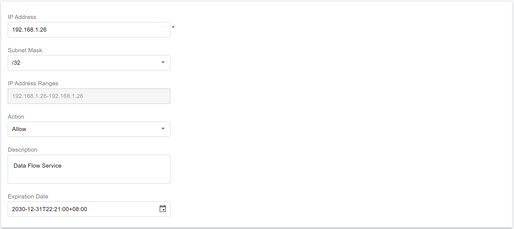
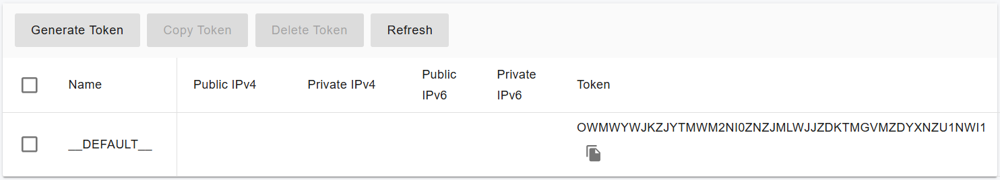
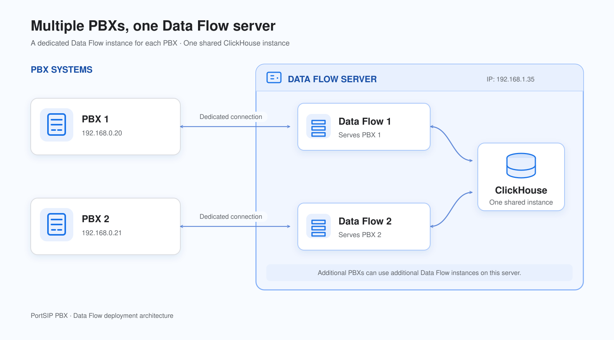

# Scaling Data Flow Server On-Premise for High Availability

With a PortSIP PBX High Availability (HA) deployment, the Data Flow Service must be installed on a separate server.

Before proceeding with this guide, ensure that you have successfully completed the [PortSIP PBX High Availability installation on Ubuntu](high-availability-installations-on-ubuntu.md).

***

### Step 1: Install Data Flow Service on a Separate Server

The **PortSIP Data Flow Service**—a high-performance analytics engine built on **ClickHouse**.

The Data Flow service powers the following advanced capabilities:

* Call Detail Record (CDR) storage and analytics
* Real-time data dashboards
* Queue wallboards for contact center operations

ClickHouse is optimized for large-scale analytical workloads, capable of handling billions of CDRs and real-time queue or agent activity data with extremely fast query performance. This makes it ideal for service providers and enterprise-grade deployments.

#### Hardware Requirements <a href="#hardware-requirements" id="hardware-requirements"></a>

For best performance, ensure your hardware meets or exceeds the specifications below. For additional reference, see the [**ClickHouse official best practices documentation**](https://clickhouse.com/docs/guides/sizing-and-hardware-recommendations).

**Minimum Requirements**

* **vCPU**: 4 cores
* **Memory**: 8 GB
* **Disk**: 128 GB SSD

***

**Recommended Requirements**

* **vCPU**: 8 cores
* **Memory**: 16 - 32 GB
* **Disk**: 256GB or larger (NVMe SSD preferred)

***

**Hardware Sizing Formula (Large-Scale Deployments)**

For large or high-volume environments, use the following guideline:

* **vCPU**: ≥ 8
* **Memory**: vCPU × 4 GB
* **Disk**: Based on expected CDR volume and data retention policy

***

#### Supported Linux Operating System

To ensure compatibility and stability, all servers in the HA environment must use a consistent Linux OS.

* **Supported OS:** Ubuntu 24.04 (64-bit)
* The Data Flow server **must run the same OS version** as the PBX HA nodes.

***

#### User Account Requirements

For seamless integration with the HA environment, the Data Flow server must meet the following user account requirements:

* The Data Flow server **must use the same username and password as the PBX servers**
* In this guide, the username **`pbx`** is used as an example
* The user account **must have sudo privileges** to execute administrative commands

***

#### Disk Space Recommendations

To ensure stable operation and sufficient capacity for growth, we recommend the following disk allocations:

* Minimum **128 GB**
* Used for storing call detail records (CDRs), logs, recordings, and messaging data

If your deployment handles **very large call volumes**, increase the data volume size accordingly, as described in the earlier sections of this guide.

***

#### Network Requirements <a href="#network-requirements" id="network-requirements"></a>

**Static IP Address**

You must configure a **static private IP address** for the Data Flow server.

* Example private IP: `192.168.1.26`

If a static private IP is not available, the server must have a **static public IP address** and be able to communicate reliably with the PBX server.

***

#### Step 1: Prepare the Linux Server for Data Flow Installation

The following tasks **must be completed before installing the Data Flow service**:

* Ensure the system date and time are correctly synchronized
* Assign a static private IP address: Example: `192.168.1.26`
* Install all available system updates and service packs
* Do not install PostgreSQL on the **Data Flow** server
* Disable all power-saving features: Set the system to High Performance mode
* Do not install:
  * TeamViewer
  * VPN software
  * Similar remote-access tools
* The server must not act as:
  * DNS server
  * DHCP server

These requirements ensure optimal performance and avoid conflicts with the Data Flow service.

***

#### Step 2: Configure the IP Address Whitelist

> ⚠️ **IMPORTANT**\
> This step is **mandatory**.\
> The  Data Flow service **will not function correctly** unless the  Data Flow server IP address is added to the PBX whitelist.

To prevent the PBX from applying request-rate limits to the  Data Flow service, you must whitelist the  Data Flow server IP address.

#### Whitelist Configuration Steps

1. Sign in to the **PBX Web Portal** as a **System Administrator**
2. Navigate to **IP Blacklist**
3. Click **Add**
4. Enter the Data Flow **server IP address**
5. Set a **long expiration date**
6. Save the configuration

<figure><figcaption></figcaption></figure>

This ensures uninterrupted communication between the PBX and the data flow service.

***

#### Step 3: Generate a Token for the Data Flow Server

To allow the Data Flow server to securely authenticate with the PortSIP PBX HA cluster, you must generate a Data Flow server token from the PBX Web Portal.

1. Sign in to the **PortSIP PBX Web Portal** as a **System Administrator**.
2. Navigate to **Servers > Data Flow**.
3. Select the **default Data Flow** **server**.
4. Click **Generate Token**.

The generated token will be used during the Data Flow service installation to establish a trusted and secure connection between the PBX HA cluster and the Data Flow server.

<figure><figcaption></figcaption></figure>

> ⚠️ **IMPORTANT**\
> All commands below for extended servers **must be executed on the `pbx01` node**, regardless of whether it is currently the active node.

#### Step 4: Set Up Password-Free SSH Login

To allow the PBX HA cluster to deploy and manage the Data Flow service, configure password-free SSH access to the Data Flow server.

If prompted to confirm the host authenticity (**yes/no**), type **`yes`** and press **Enter**.

Run the following command **from `pbx01`**:

```bash
ssh-copy-id -i ~/.ssh/id_rsa.pub pbx@192.168.1.26
```

After this step, `pbx01` will be able to access the Data Flow server without requiring a password.

***

#### Step 5: Deploy the Data Flow Service

The data flow service deployment **must be initiated from the `pbx01` node** of the PBX HA cluster.

> ⚠️ **IMPORTANT**\
> The deployment process may take several minutes.\
> **Do not interrupt the process, reboot any server, or close the terminal** until the command completes.

**Command parameters**

* `-p` : Path for storing Data Flow and ClickHouse data (required)
* `-d` : ClickHouse Docker image
* `-a` : Private IP address of the Data Flow server
* `-A` : Public IP address (used if private IP is not available)
* `-i` : PortSIP PBX Docker image version (required)

Example:

```bash
cd /opt/portsip-pbx-ha-guide/ && \
/bin/bash dataflow.sh run \
-p /var/lib/portsip \
-a 192.168.1.26 
```

#### Operational Notes (Data Flow)

* If the **PBX IP address changes**, you must delete and recreate the existing Data Flow Docker instance.
* If a **new authentication token** is generated, the Data Flow Docker instance must be deleted and recreated.
* After upgrading the **PBX to a new version**, you must remove and recreate the Data Flow Docker instance to ensure compatibility.

The above operations **do not affect or erase existing analytics data** stored in ClickHouse.

***

### Step 2: Install Multiple Data Flow Instances on One Server

**This step is optional.**&#x20;

Complete this step only if you need to deploy multiple Data Flow instances on a single server to serve multiple PortSIP PBX HA clusters.

Supported starting with PortSIP PBX v22.8.0. You can install multiple Data Flow instances on one server, with one instance for each PBX. The instances **share one ClickHouse instance** and use the **same Data Flow server IP**. Each instance connects to its corresponding PBX.

<figure><figcaption></figcaption></figure>

A single Data Flow server supports up to **100 Data Flow instances**. For typical deployments, we recommend **around 10 instances** and generally advise **no more than 20 instances** per server. The practical limit depends on the server's CPU, memory, storage performance, and the combined workload of the connected PBXs.

#### Install Additional Data Flow Instances

After completing **Step 1** to install the first Data Flow instance for **HA PBX 1**, follow these steps to install an additional instance for **HA PBX 2**:

1. Log in to the **pbx01** node of **HA PBX 2**.
2. Repeat the installation procedure described in **Step 1**.
3. Replace the PBX-specific configuration values with the corresponding information for **HA PBX 2**.
4. Specify the **same Data Flow server IP address** used for HA PBX 1.

The installer will deploy an additional Data Flow instance on the existing Data Flow server. This instance will connect to HA PBX 2 while sharing the existing ClickHouse instance.

To connect more PBX HA clusters, repeat this procedure on the **pbx01** node of each additional cluster.

**Important:** Do not install a separate ClickHouse instance for each Data Flow instance. All Data Flow instances on the same server must share the existing ClickHouse instance.

***

### Managing the Data Flow Server

All Data Flow server management operations are performed using the `dataflow.sh` script provided with the PortSIP PBX HA deployment.

> ⚠️ **IMPORTANT**\
> All commands in this section **must be executed on the `pbx01` node**, regardless of which PBX node is currently active.

***

#### Available Operations

The following operations are supported for managing the data flow server:

* **start** – Start the data flow service
* **stop** – Stop the data flow service
* **restart** – Restart the data flow service
* **upgrade** - Upgrade the data flow service
* **rm** – Remove the data flow service installation

***

#### Data Flow Server Management Commands

Run the appropriate command on **`pbx01`** based on the required operation.

**Start the Data Flow Server**

```bash
cd /opt/portsip-pbx-ha-guide/ && /bin/bash dataflow.sh start
```

**Stop the Data Flow Server**

```bash
cd /opt/portsip-pbx-ha-guide/ && /bin/bash dataflow.sh stop
```

**Restart the Data Flow Server**

```bash
cd /opt/portsip-pbx-ha-guide/ && /bin/bash dataflow.sh restart
```

**Remove the Data Flow Server**

```bash
cd /opt/portsip-pbx-ha-guide/ && /bin/bash dataflow.sh rm
```

> ⚠️ **WARNING**\
> Removing the Data Flow server will stop messaging services and delete the Data Flow service installation.\
> Ensure this operation is performed only during maintenance windows.

***

### Upgrading the Data Flow Server

Follow the steps below to upgrade the Data Flow server in a PortSIP PBX HA environment.

> ⚠️ **IMPORTANT**\
> All upgrade steps **must be performed on the `pbx01` node**, even if `pbx01` is not the current active PBX node.

#### Prerequisites

Before upgrading the Data Flow server:

* Ensure that the PBX HA cluster has already been upgraded by following the guide: [Upgrading High Availability Installation](upgrading-high-availability-installation.md)&#x20;
* Ensure the PBX HA cluster is operating normally

***

### **Upgrade the Data Flow Server**

On the **`pbx01`** node, run the following command to upgrade the Data Flow service.

**Important:** If you have installed multiple Data Flow instances on the same server as the above **Step 2**, you only need to perform the upgrade **once**, from the **`pbx01` node of HA PBX 1**. The upgrade will apply to all Data Flow instances running on that server. There is no need to repeat the upgrade procedure for each PBX HA cluster.

```bash
cd /opt/portsip-pbx-ha-guide/ && /bin/bash dataflow.sh upgrade -d portsip/clickhouse:26.3
```

> ⚠️ **IMPORTANT**\
> The upgrade process may take several minutes.\
> **Do not interrupt the process, reboot any server, or close the terminal** until the command completes.

Once the upgrade finishes successfully, the Data Flow service will be restarted automatically with the updated version.

