# Keycloak Integration

PortSIP PBX supports integration with Keycloak as an identity provider (IdP) for single sign-on (SSO) and SCIM user directory synchronization. This guide covers prerequisites, Keycloak configuration, PBX configuration, and verification of user synchronization and sign-in, in that order.

**Choose one SSO protocol: OIDC or SAML 2.0.** Sections 2.2 and 2.3 describe mutually exclusive alternatives. Choose the one that fits your deployment. After completing either section, proceed directly to Section 2.4. You do not need to create both SSO clients. The SCIM client is independent of the SSO protocol; both options use the directory synchronization configuration in Sections 2.4 through 2.6.

For other software that supports OIDC and SAML 2.0, you can use this guide as a reference and adapt the configuration to the endpoints, fields, and permissions available in that software. User directory synchronization also requires a compatible SCIM interface. If you need assistance, contact [PortSIP Support](https://www.portsip.com/support/).

***

### 1 Prerequisites and Configuration Details

#### 1.1 Environment Requirements

Before you begin, make sure the following requirements are met:

* **You must have successfully deployed and configured Keycloak in your own environment. The Keycloak configuration in this guide is provided for demonstration and reference purposes only.** This guide does not cover installing or starting Keycloak, or deploying it in a production environment.
* You have a Keycloak administrator account and an administrator account for the target PortSIP PBX tenant.
* Your PortSIP PBX provides the Generic IdP integration feature. Sign in to the PortSIP PBX Web Portal as a tenant administrator. If you sign in as a system administrator, switch to the target tenant.
* The PBX, SBC (if installed and configured), and users' browsers can access the Keycloak HTTPS URL and trust its certificate. Users' browsers can also access the PBX/SBC sign-in and callback URLs.
* Your Keycloak environment provides the SCIM API and allows it to be enabled for the target realm. Feature availability and the user interface may vary by version. Check the documentation for your deployed version. If the SCIM API option is unavailable, ask your Keycloak administrator to verify that the environment meets the requirements before proceeding.

The Keycloak screenshots in this guide were taken in the original configuration environment, which used Keycloak 26.8.0. They show where to perform each action. The fields and menus in your deployed version take precedence.

#### 1.2 Example Values

**`https://example.com` is a placeholder for the Keycloak URL. Replace it with the HTTPS URL of your own Keycloak service.** If your URL includes a port or path prefix, retain the full URL. When configuring endpoints, use the values published by your actual environment.

| Item                                                 | Example Value or Source                                                            |
| ---------------------------------------------------- | ---------------------------------------------------------------------------------- |
| Keycloak service URL                                 | `https://example.com`                                                              |
| Realm                                                | `portsip-lab`                                                                      |
| OIDC client ID (OIDC option only)                    | `portsip-pbx-oidc`                                                                 |
| SAML client ID / PBX SP Entity ID (SAML option only) | `portsip-pbx-saml`                                                                 |
| SCIM client ID (used by both options)                | `portsip-pbx-scim`                                                                 |
| Test username                                        | `alice`                                                                            |
| PBX / SBC callback URLs                              | Copy these from the target tenant's Generic IdP page in the PortSIP PBX Web Portal |

Other domain names, extensions, usernames, and secrets shown in the screenshots are also examples. Do not copy them directly into your configuration.

#### 1.3 Copy the Callback URLs and Record Configuration Values

1. Sign in to the PortSIP PBX Web Portal and open the **Generic IdP** integration page for the target tenant.
2. Select the SSO protocol you intend to use (OIDC or SAML 2.0), then copy the **PBX Redirect URL** displayed on the page.
3. If PortSIP SBC is configured, also copy the **SBC Redirect URL**. You will add each URL to the list of allowed redirect URIs for the Keycloak client later.
4. Create a blank text file named `configuration-notes.txt` to record the actual values listed below. This file will contain client secrets. Store it securely and restrict access to administrators.

| Value to Record                         | Where to Find It                                          | Applies To                                 |
| --------------------------------------- | --------------------------------------------------------- | ------------------------------------------ |
| `PBX_Redirect_URL` / `SBC_Redirect_URL` | PBX Generic IdP page                                      | OIDC and SAML                              |
| `OIDC_Client_Secret`                    | Client's Credentials tab in Section 2.2                   | OIDC only                                  |
| `SAML_Metadata_URL`                     | Realm's SAML metadata link in Section 2.3                 | SAML only                                  |
| `SCIM_Client_Secret`                    | Client's Credentials tab in Section 2.4                   | OIDC and SAML                              |
| `Issuer_URL`                            | The issuer field in the discovery document in Section 2.5 | OIDC SSO only                              |
| `Token_URL` / `SCIM_Base_URL`           | Section 2.5                                               | Directory synchronization for both options |

Complete the Keycloak configuration and record the values first, then enter them together in the PBX. This reduces the need to repeat work if the PBX page session expires.

***

### 2 Configure Keycloak

#### 2.1 Create a Realm and Enable the SCIM API

1. Sign in to the Admin Console of your deployed Keycloak service.
2. Open **Manage realms > Create realm**, enter `portsip-lab`, and save. Configure all clients and users in this same realm throughout the following steps.

<figure>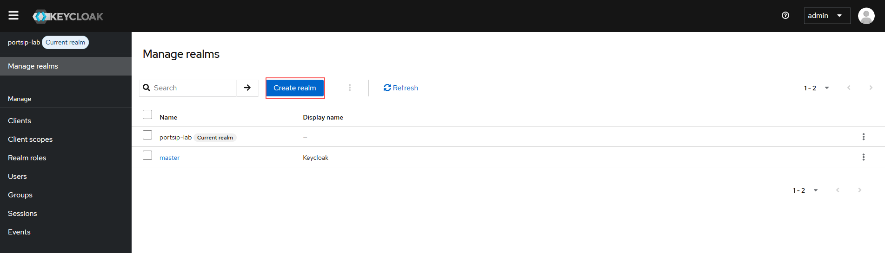<figcaption></figcaption></figure>

3. Make sure the correct realm is selected, then go to **Realm settings > General**.
4.  Set **SCIM API** to **Enabled / On** and click **Save**.

    **Note:** In the Keycloak 26.8.0 environment used for this guide, this option must be enabled at the realm level. Otherwise, the SCIM interface returns a 404 error.

<figure>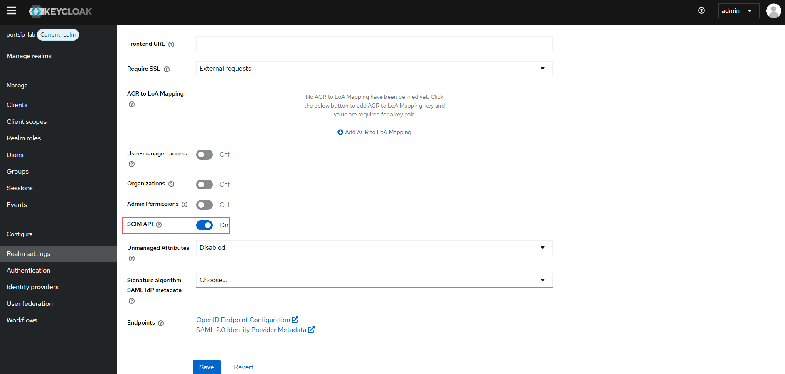<figcaption></figcaption></figure>

**Next: If you chose OIDC, follow Section 2.2. If you chose SAML 2.0, follow Section 2.3. Complete only one of these sections.**

#### 2.2 Option A: Configure an OIDC Client (Choose This or Section 2.3)

This section applies only if you are using OIDC. If you chose SAML 2.0, skip this section and follow Section 2.3. After completing this section, skip Section 2.3 and proceed directly to Section 2.4.

1. In the current realm, open **Clients > Create client**.
2. Under **General settings**, set **Client type** to `OpenID Connect`, enter `portsip-pbx-oidc` as the **Client ID**, and click **Next**.

<figure>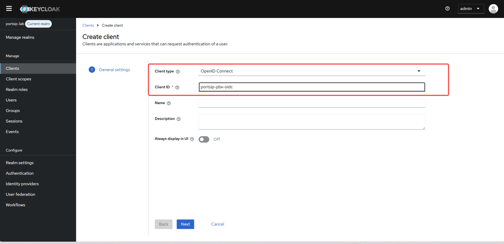<figcaption></figcaption></figure>

3. Under **Capability config**, turn on **Client authentication**, select **Standard flow**, turn on **Require PKCE**, and click **Next**.

<figure>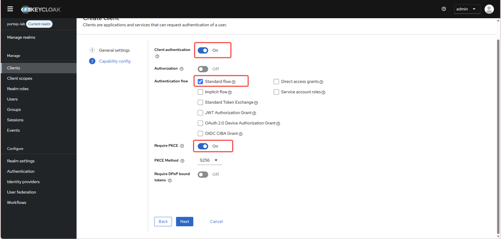<figcaption></figcaption></figure>

4. Under **Login settings > Valid redirect URIs**, paste the **PBX Redirect URL** you copied in Section 1.3. If you also have an **SBC Redirect URL**, add another row and paste that URL. Click **Save**.

<figure>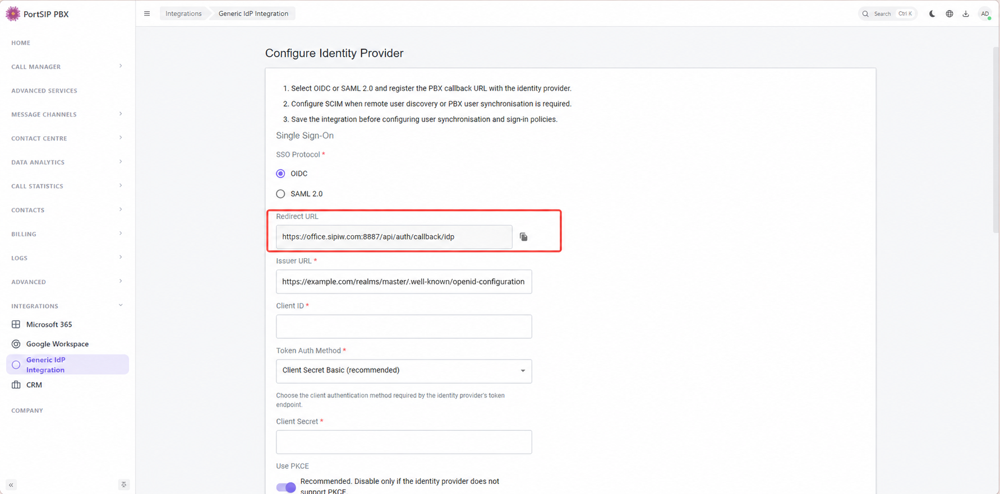<figcaption></figcaption></figure>

<figure>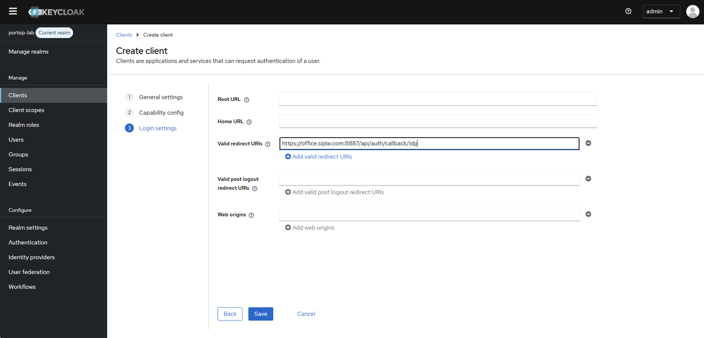<figcaption></figcaption></figure>

5. Open the client's **Credentials** tab, copy the **Client Secret**, and record it as `OIDC_Client_Secret`.

<figure>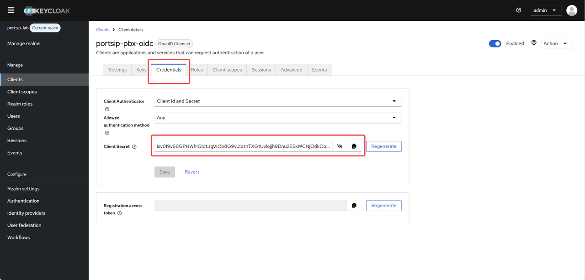<figcaption></figcaption></figure>

**Check:** The callback URLs must match the values displayed in the PBX exactly, including the scheme, domain name, port, and path. If a PBX or SBC URL changes, update the corresponding value in Keycloak as well.

#### 2.3 Option B: Configure a SAML Client (Choose This or Section 2.2)

This section applies only if you are using SAML 2.0. If you have completed Section 2.2, skip this section. After completing this section, continue to Section 2.4.

1. In the current realm, open **Clients > Create client**.
2. Under **General settings**, set **Client type** to `SAML`, enter `portsip-pbx-saml` as the **Client ID**, and click **Next**. Later, enter the same value in the PBX **SP Entity ID** field.

<figure>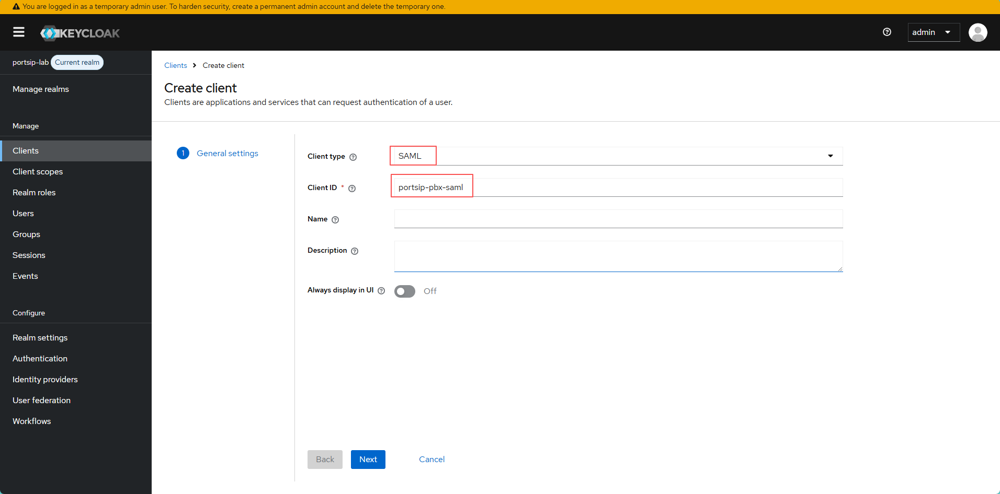<figcaption></figcaption></figure>

3. Under **Login settings > Valid redirect URIs**, paste the **PBX Redirect URL** you copied in Section 1.3. If you also have an **SBC Redirect URL**, add another row and enter it. Click **Save**.

<figure>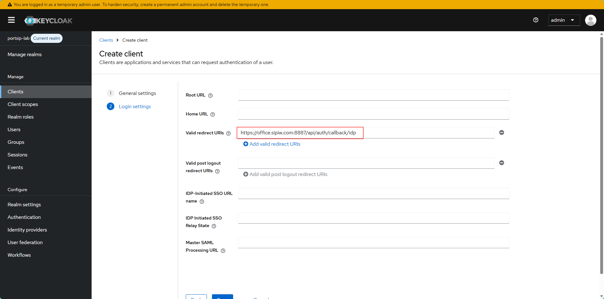<figcaption></figcaption></figure>

4. Open the client's **Keys** tab and set **Client signature required** to **Off**.

<figure>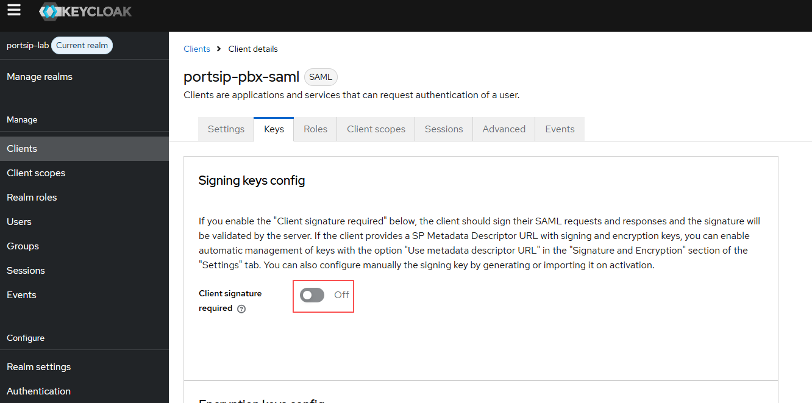<figcaption></figcaption></figure>

5. Go to **Realm settings > General > Endpoints** and click **SAML 2.0 Identity Provider Metadata**.

<figure>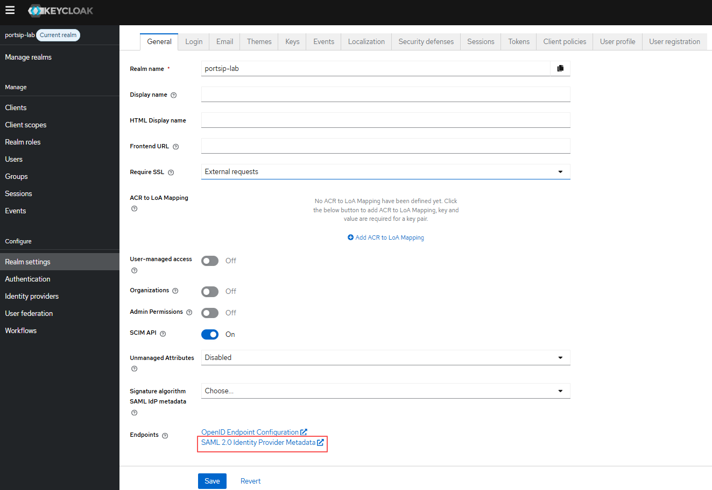<figcaption></figcaption></figure>

6. Copy the full URL of the page that opens and record it as `SAML_Metadata_URL`. In this example, the URL is:

```
https://example.com/realms/portsip-lab/protocol/saml/descriptor
```

**Check:** The metadata must come from the realm used for this integration, and the PBX must be able to access this URL. Do not enter the metadata URL in a callback URL field.

#### 2.4 Create a SCIM Client for User Synchronization

Complete this section whether you chose OIDC or SAML 2.0. The PBX uses this client to obtain tokens for directory synchronization. Configure it separately from the SSO client created above.

1. Open **Clients > Create client**.
2. Set **Client type** to `OpenID Connect`, enter `portsip-pbx-scim` as the **Client ID**, and click **Next**.

<figure>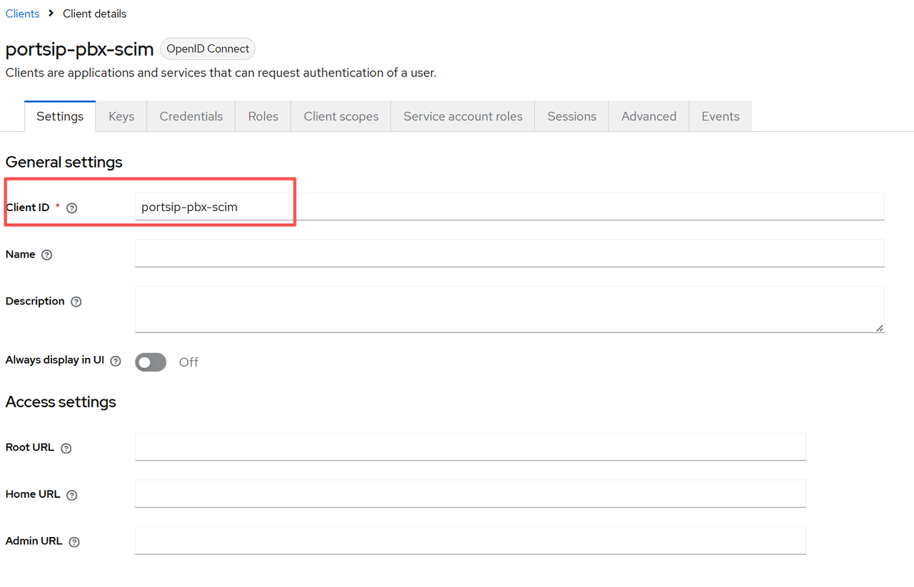<figcaption></figcaption></figure>

3. Under **Capability config**, enable only **Client authentication** and **Service accounts roles**. Disable **Standard flow** and the other authentication flows, then save.

<figure>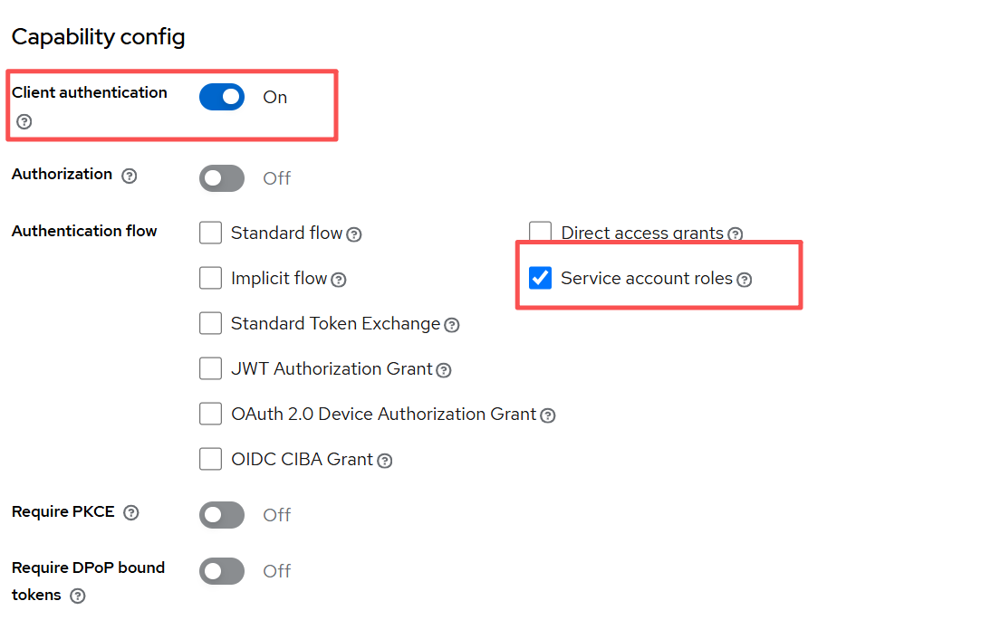<figcaption></figcaption></figure>

4. Open the client's **Credentials** tab, copy the **Client Secret**, and record it as `SCIM_Client_Secret`. Do not confuse this secret with the OIDC SSO client secret.

#### 2.5 Obtain the Endpoint URLs

1. Go to **Realm settings > General > Endpoints** and click **OpenID Endpoint Configuration**. Even if you chose SAML SSO, you still need the Token URL for the SCIM client.

<figure>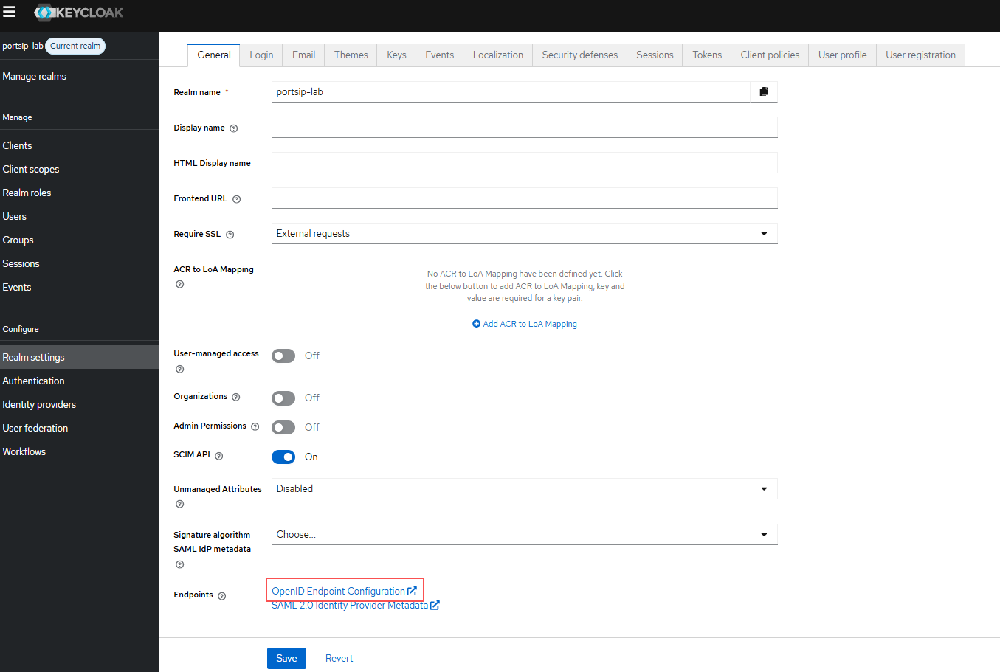<figcaption></figcaption></figure>

2. In the JSON document that opens, find `issuer` and `token_endpoint`. Record their full values as `Issuer_URL` and `Token_URL`, respectively.
3.  Append `/scim/v2` to the `Issuer_URL` you just recorded, and record the result as `SCIM_Base_URL`.

    | Parameter       | Example Used in This Guide                                             |
    | --------------- | ---------------------------------------------------------------------- |
    | `Issuer_URL`    | `https://example.com/realms/portsip-lab`                               |
    | `Token_URL`     | `https://example.com/realms/portsip-lab/protocol/openid-connect/token` |
    | `SCIM_Base_URL` | `https://example.com/realms/portsip-lab/scim/v2`                       |

<figure>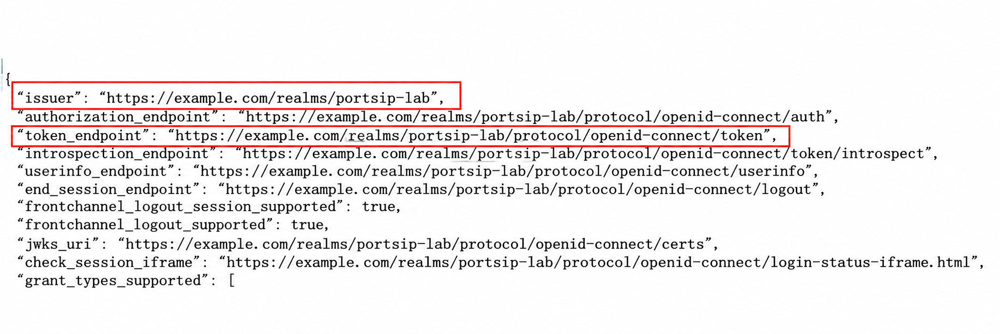<figcaption></figcaption></figure>

**Check:** The SCIM Base URL should end with `/scim/v2` and must not include `/Users`. If you use a reverse proxy, make sure the scheme, hostname, port, and path in the discovery document match the externally accessible URLs.

#### 2.6 Assign SCIM Client Permissions and Configure the Audience

1. Open **Clients > portsip-pbx-scim > Service account roles**.
2. Click **Assign role**, select **Client roles**, and search for `users`. Select `manage-users` and `view-users`, then click **Assign**.

<figure>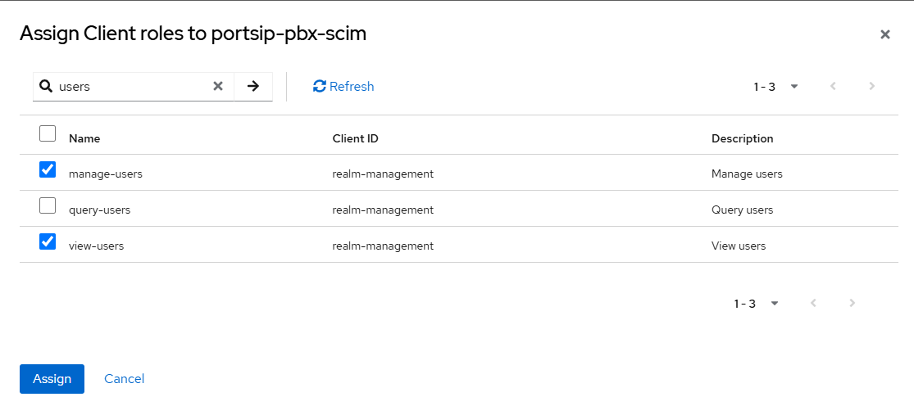<figcaption></figcaption></figure>

3. Confirm that the service account's role list includes `manage-users` and `view-users`.

<figure>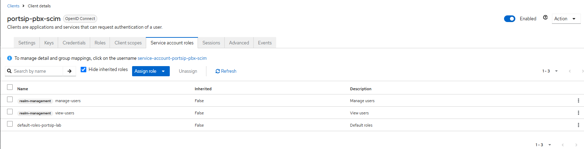<figcaption></figcaption></figure>

4. Open **Client scopes**, click the dedicated scope `portsip-pbx-scim-dedicated`, and then click **Configure a new mapper**.

<figure>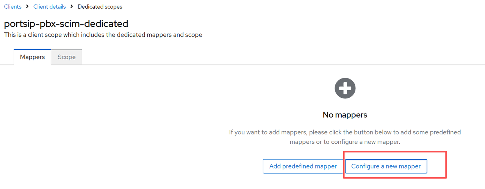<figcaption></figcaption></figure>

5. Select **Audience**.

<figure>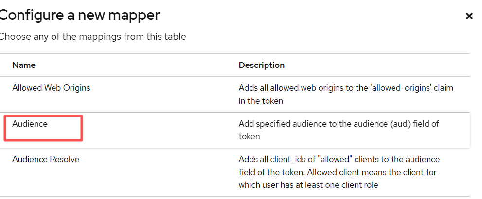<figcaption></figcaption></figure>

6. Configure the following fields and click **Save**.

| Field                    | Value                                       |
| ------------------------ | ------------------------------------------- |
| Name                     | `scim-audience`                             |
| Included Custom Audience | The `SCIM_Base_URL` recorded in Section 2.5 |
| Add to access token      | `On`                                        |

<figure>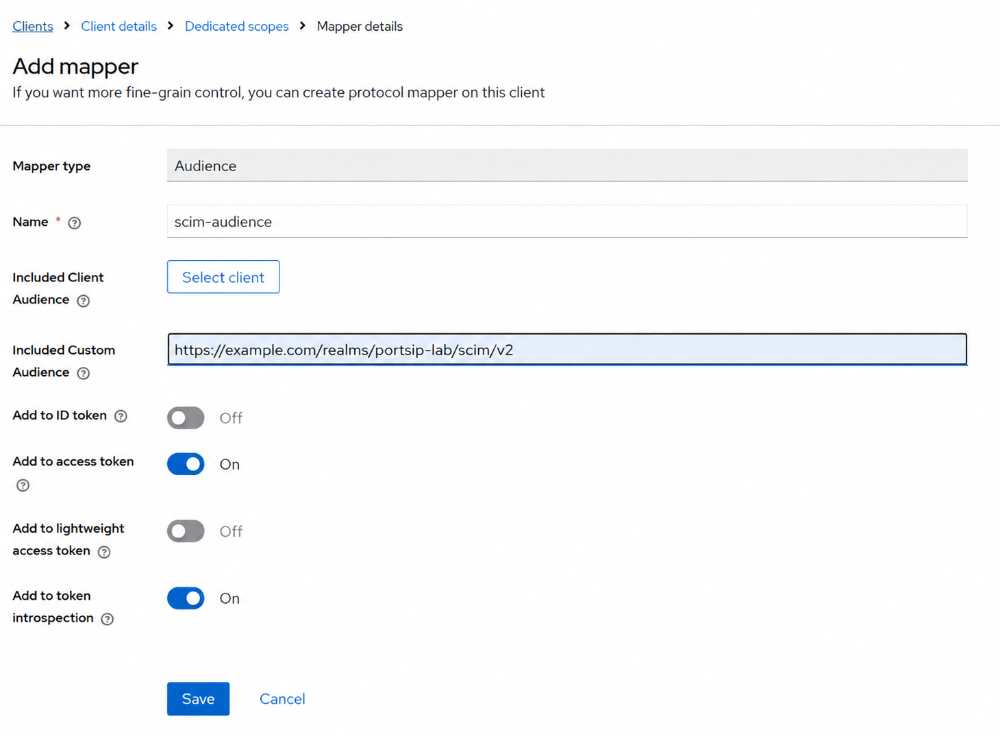<figcaption></figcaption></figure>

**Check:** The audience must exactly match the SCIM API base URL that Keycloak validates, including the scheme, host, port, and path. In this example, it is `https://example.com/realms/portsip-lab/scim/v2`.

#### 2.7 Create a Test User

1. Open **Users > Create new user**, enter `alice` as the **Username**, and click **Create**.

<figure>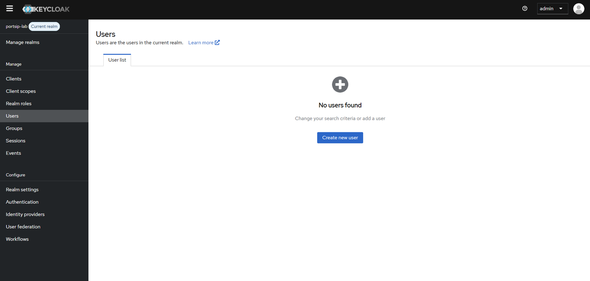<figcaption></figcaption></figure>

<figure>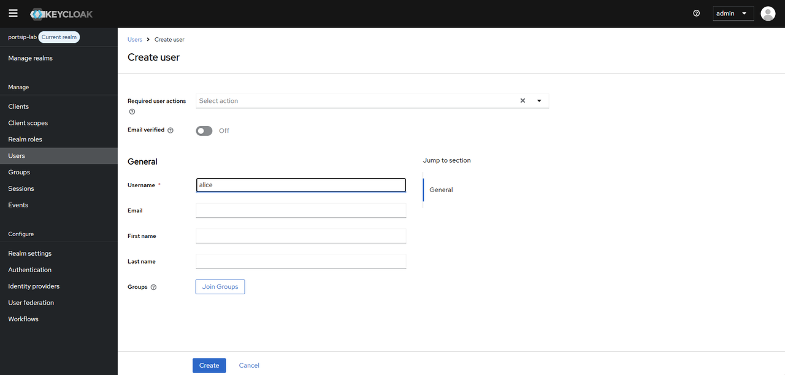<figcaption></figcaption></figure>

2. For `alice`, open **Credentials > Set password**, enter a test password (for example, `alice123`), set **Temporary** to **Off**, and save.

<figure>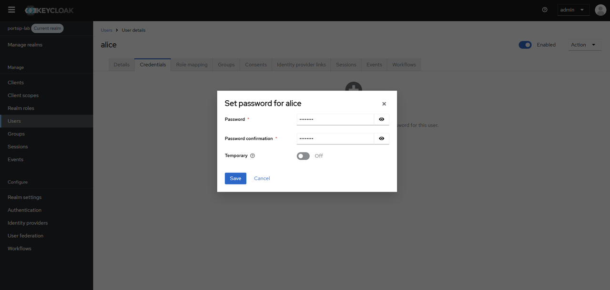<figcaption></figcaption></figure>

3. Confirm that the user is enabled and note the username. Make sure you have recorded all the values in Section 1.3 that apply to your chosen protocol, then return to the PBX.

***

### 3 Configure PortSIP PBX

In the PortSIP PBX Web Portal, open **Advanced > Integrations > Generic IdP** for the target tenant. Use your recorded values to complete the following configuration. If the page session has expired, sign in again and switch to the same tenant.

#### 3.1 Configure Single Sign-On

Enter only the set of values for the option you selected in Section 2.

**Option A: OIDC (Corresponds to Section 2.2)**

| PBX Field         | Value                                                          |
| ----------------- | -------------------------------------------------------------- |
| SSO Protocol      | `OIDC`                                                         |
| Issuer URL        | `Issuer_URL`                                                   |
| Client ID         | `portsip-pbx-oidc`, or the OIDC client ID you actually created |
| Token Auth Method | Keep the default, `Client Secret Basic`                        |
| Client Secret     | `OIDC_Client_Secret`                                           |
| Use PKCE          | Keep enabled                                                   |

**Option B: SAML 2.0 (Corresponds to Section 2.3)**

| PBX Field    | Value                                                                         |
| ------------ | ----------------------------------------------------------------------------- |
| SSO Protocol | `SAML 2.0`                                                                    |
| SP Entity ID | `portsip-pbx-saml`; this must match the Client ID of the Keycloak SAML client |
| Metadata URL | `SAML_Metadata_URL`                                                           |

#### 3.2 Configure the SCIM User Directory

Enter the following values in the **SCIM User Directory** section. This configuration applies to both SSO options.

| PBX Field             | Value                                                          |
| --------------------- | -------------------------------------------------------------- |
| SCIM Base URL         | `SCIM_Base_URL`                                                |
| Authentication Method | `OAuth 2.0 Client Credentials`                                 |
| Token URL             | `Token_URL`                                                    |
| Token Client ID       | `portsip-pbx-scim`, or the SCIM client ID you actually created |
| Token Client Secret   | `SCIM_Client_Secret`                                           |

#### 3.3 Configure User Identifier Mapping and Save

Under **Advanced Attribute Mapping**, configure the user identifiers for your selected SSO protocol.

* **OIDC User Identifier**: We strongly recommend changing this to `preferred_username` to avoid using the default UUID identifier, `sub`.
* **SCIM User Identifier**: Enter `userName`.

<figure>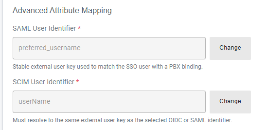<figcaption></figcaption></figure>

* **SAML User Identifier**: Enter `NameID`.

<figure>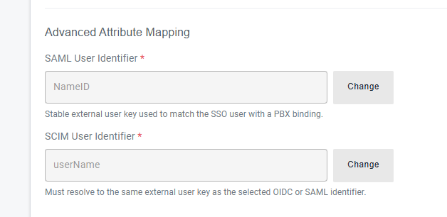<figcaption></figcaption></figure>

* **Sync Schedule**: Select `Manual` (manual synchronization) for the initial test.

Click **Save** at the bottom of the page. Confirm that the configuration has been saved successfully before verifying synchronization and sign-in.

***

### 4 Verify User Synchronization and Enable SSO

#### 4.1 Synchronize or Link the Test User

Under **Generic IdP > User Sync**, choose the method that meets your needs. **Sections 4.1.1 and 4.1.2 are alternatives. Complete only one; each has its own steps starting at 1. After completing either method, continue to Section 4.2.**

**4.1.1 Automatic Synchronization**

1. Open the **User Sync** tab and select `Automatic` mode.
2. Go to **Call Manager > Users** and confirm that `alice` has been synchronized successfully.

**4.1.2 Manual Synchronization and Linking to an Existing PBX User**

1. Open the **User Sync** tab, select `Manual`, and click **Add**.
2. Find `alice` in the external user list. If the user is not listed, first check the SCIM connection and permissions as described in Section 5.
3. Click **Link PBX User** for that user.

<figure>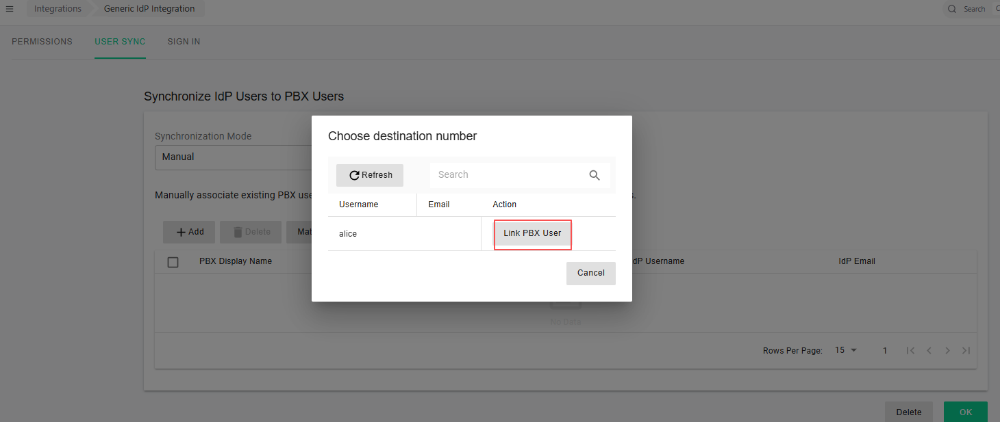<figcaption></figcaption></figure>

4. Select the existing PBX user or extension you want to use for the test, then click **OK** to confirm.

<figure>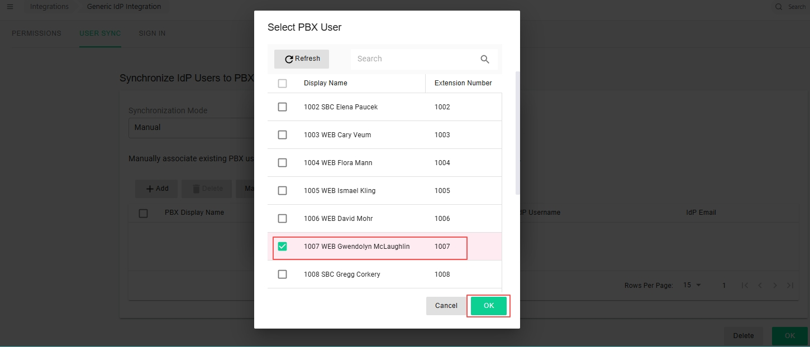<figcaption></figcaption></figure>

5. Confirm that the link was created successfully. The **Link PBX User** button becomes unavailable for a user who is already linked. Click **Cancel** to close the selection window, then return to the synchronization list and verify the association.

<figure>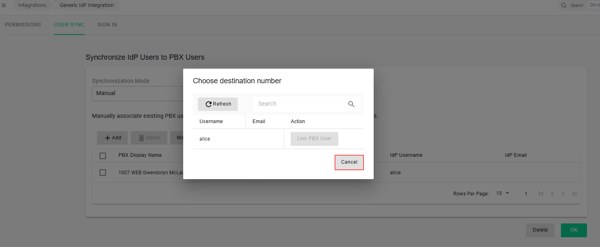<figcaption></figcaption></figure>

#### 4.2 Enable Single Sign-On

Complete this section whether you synchronized users automatically or linked them manually.

1. Return to **Generic IdP** and open the **Sign In** tab (shown as **SignIn** in some interfaces).
2. Turn on the SSO switch.
3. Select which users are allowed to use SSO, for example, `All users`, and save.

<figure>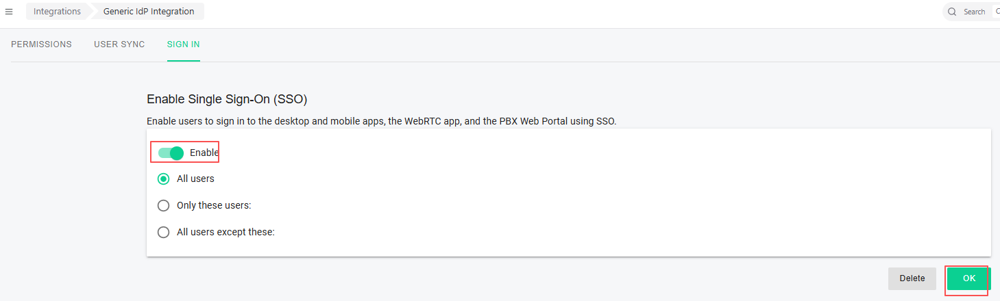<figcaption></figcaption></figure>

#### 4.3 Verify SSO Sign-In

1. Sign out of the PBX. On the sign-in page, enter the **SIP Domain** of the target tenant associated with the SSO configuration, then click **Next**.
2. Click the **Generic IdP** sign-in button.

<figure>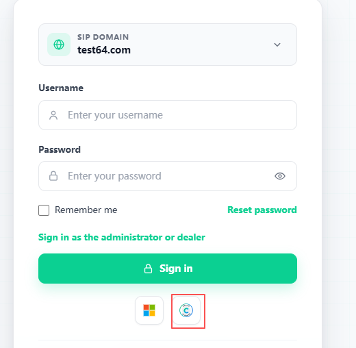<figcaption></figcaption></figure>

3. When you are redirected to Keycloak, enter `alice` and the password set in Section 2.7 (`alice123` in this example).

<figure>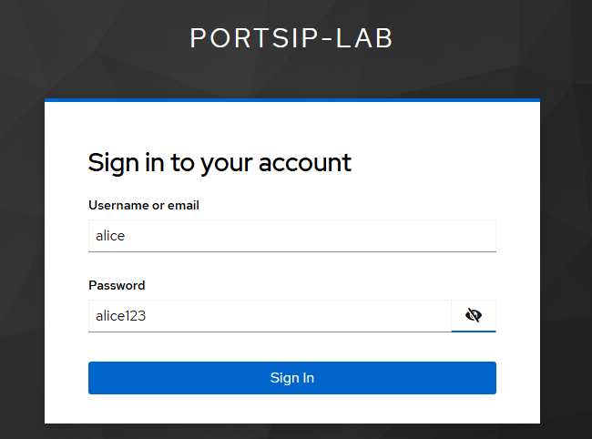<figcaption></figcaption></figure>

4. On the first sign-in, follow the prompts to enter Email, First name, and Last name, then click **Submit**.

<figure>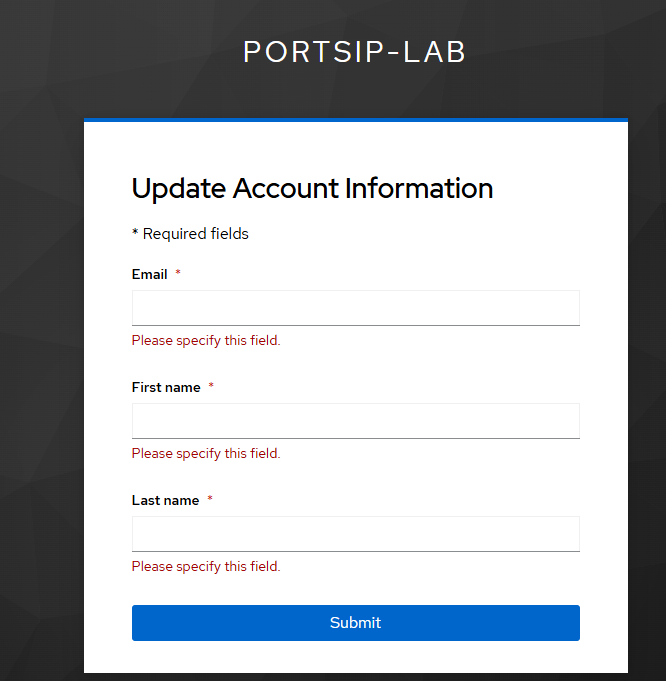<figcaption></figcaption></figure>

4. Confirm that the browser returns to the PBX and signs you in successfully. The signed-in account must match the PBX user synchronized or linked in Section 4.1.

**Successful verification means:** SCIM can retrieve the test user and synchronize or link that user; the Generic IdP option appears on the PBX sign-in page; and, after authenticating with Keycloak, the user returns to the PBX and accesses the correct user account.

***

### 5 Troubleshooting

#### 5.1 The SCIM Interface Returns 404

* Confirm that your deployed Keycloak version and configuration provide the SCIM API, and that **SCIM API** is enabled for the correct realm as described in Section 2.1.
* Check the realm name, path prefix, and `/scim/v2` portion of `SCIM_Base_URL`. If you use a reverse proxy, confirm that it forwards this path.
* Confirm that the SCIM API feature is enabled in the Keycloak service as required by the original environment (the feature argument used in the original guide was `--features=scim-api`). The Keycloak administrator is responsible for service deployment and startup configuration.
* Once the feature is enabled correctly, opening the `/Users` URL under `SCIM_Base_URL` directly in a browser should return `401 Unauthorized`.

#### 5.2 SCIM Synchronization Returns 401 or 403

* Check **Token URL**, **Token Client ID**, and **Token Client Secret**. SCIM authentication must use the dedicated client and secret from Section 2.4.
* Confirm that **Client authentication** and **Service accounts roles** are enabled, and that the service account has the required roles.
* Check that the audience exactly matches the SCIM API base URL. Look for a missing HTTPS scheme, port, or path, or an incorrectly appended `/Users`.
* Confirm that **Add to access token** is enabled in the Audience mapper. After making changes, verify the configuration with a newly obtained access token.

#### 5.3 SSO Redirection Fails or the Callback URL Does Not Match

* Confirm that the Keycloak **Valid redirect URIs** exactly match the callback URLs displayed in the PBX. If you use an SBC, confirm that its callback URL has also been added.
* Make sure the protocol selected in the PBX matches the type of SSO client you created.
* OIDC: Check the Issuer URL, Client ID, Client Secret, and PKCE settings.
* SAML: Check that the SP Entity ID is `portsip-pbx-saml` and that the Metadata URL matches the value recorded in Section 2.3.

#### 5.4 Keycloak Authentication Succeeds but the PBX Cannot Match the User

* First, confirm that the test user has been synchronized or linked to a PBX user as described in Section 4.1.
* OIDC: Check whether **OIDC User Identifier** was incorrectly set to `sub`. The original guide strongly recommends `preferred_username`.
* SAML: Check that **SAML User Identifier** is set to `NameID` and **SCIM User Identifier** is set to `userName`.
* Check that the user is included among those allowed to use SSO, and that the SIP Domain entered at sign-in belongs to the correct tenant.

#### 5.5 Generic IdP Does Not Appear on the PBX Sign-In Page

* Confirm that the configuration has been saved and that SSO is enabled as described in Section 4.2.
* Confirm that you have selected the target tenant with the Generic IdP configuration, and check which users are allowed to use SSO.
* Test again in a new private browsing window to prevent an existing session from affecting the result.

