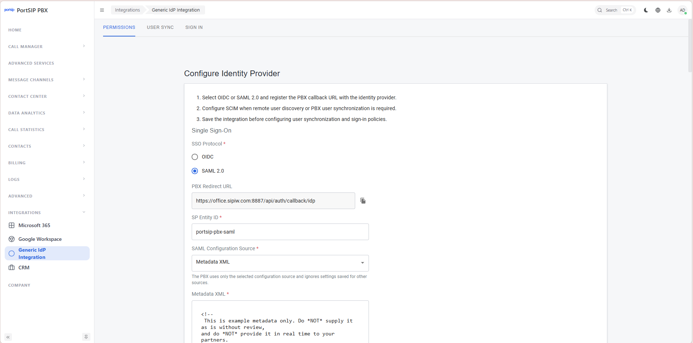
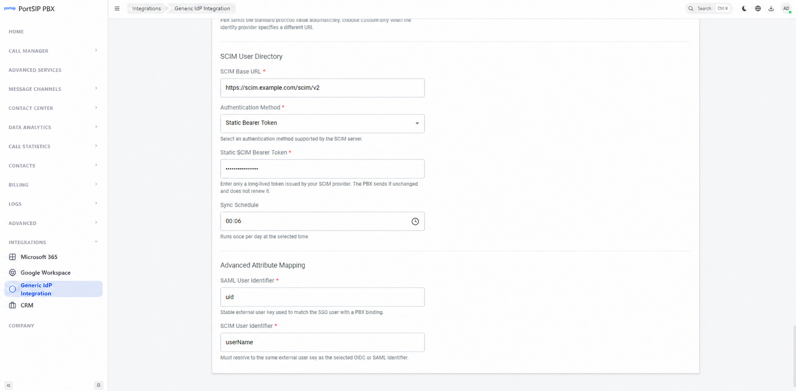
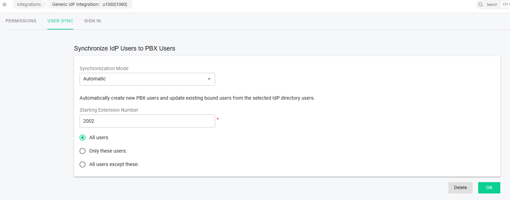
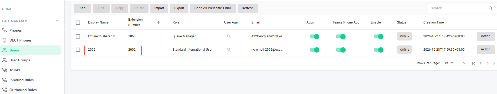
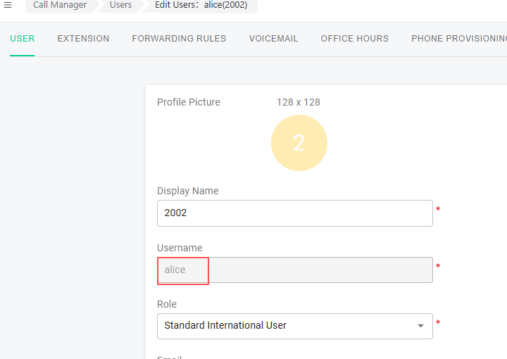
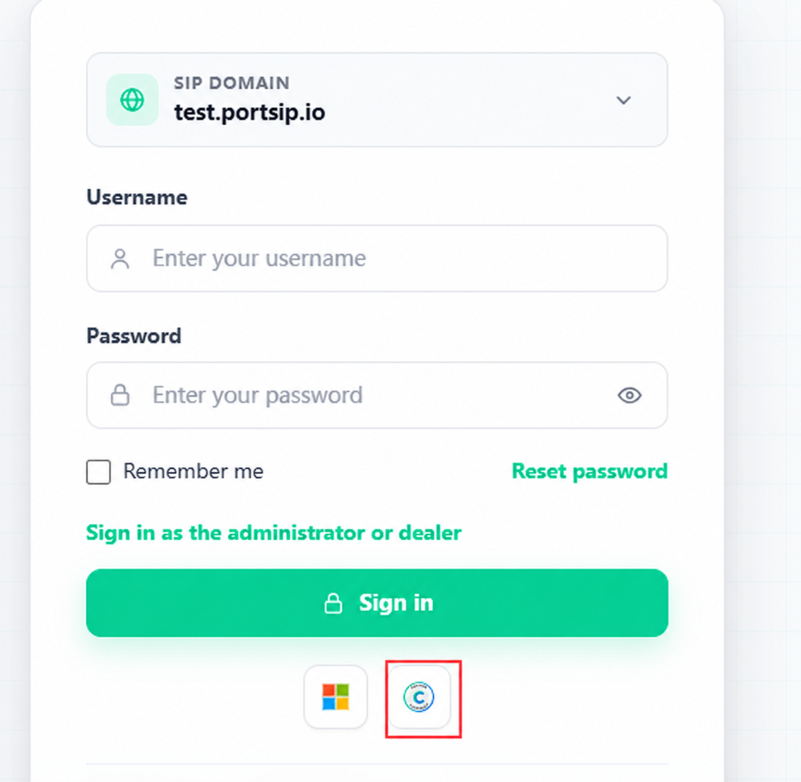
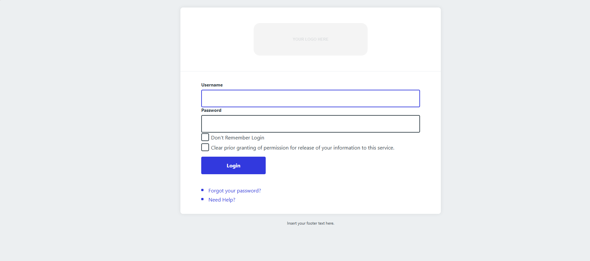

# Shibboleth Integration

This guide explains how to connect PortSIP PBX to an existing, operational Shibboleth IdP for user synchronization and single sign-on (SSO). It does not cover installing or deploying Shibboleth.

If you use another SAML 2.0 identity provider, you can refer to the PBX configuration sections. Follow that provider's documentation for its configuration. Contact PortSIP Support if you need assistance.

**Applies to: PortSIP PBX 22.9.0 and later.**

* Shibboleth IdP provides authentication through SAML 2.0.
* PBX reads the user directory through a separate SCIM 2.0 service, which must be deployed and configured before you begin.
* The IdP and SCIM service can be provided by separate products.
* Each user who needs PBX synchronization, linking, or SSO must exist in both systems. Both systems must provide matching identifiers for that user, but the two systems do not need to contain exactly the same users.
* Configuring SAML alone does not enable user synchronization.

This guide and its screenshots use the following example values:

| Parameter                  | Example value                                                                      |
| -------------------------- | ---------------------------------------------------------------------------------- |
| PBX server IP address      | `192.168.1.13`                                                                     |
| PBX Web Portal             | `https://office.sipiw.com:8887`                                                    |
| SIP DOMAIN                 | `test.portsip.io`                                                                  |
| Shibboleth IdP URL         | `https://shibboleth.example.com`                                                   |
| SCIM Base URL              | `https://scim.example.com/scim/v2`                                                 |
| SP Entity ID               | `portsip-pbx-saml`                                                                 |
| Test username / password   | `alice` / `alice123`                                                               |
| SCIM authentication method | Static Bearer Token or OAuth2 Client Credentials, as supported by your SCIM server |

Replace these values consistently with the actual values for your environment:

* SIP DOMAIN is the PBX tenant's SIP domain. It is configured separately from the Web Portal hostname.
* You must provide the SCIM server. Its hostname, port, path, authentication method, and permissions depend on the product you use.
* Example passwords and credentials are for illustration only.

***

### 1. Prerequisites

1. Shibboleth authentication is working, the test account `alice` is valid, and an administrator can maintain the IdP configuration.
2. A SCIM 2.0 service is available and returns `alice` in user queries. Prepare the credentials required by the service: a fixed token for `Authorization: Bearer` authentication, or an OAuth2 token URL, client ID, and client secret. See Section 3.2 for compatibility requirements. The SCIM user identifier must match the identifier returned by Shibboleth.
3. PBX can reach the SCIM HTTPS endpoint and trusts its certificate chain. The server certificate must be CA-signed and match the hostname used to access the service. Open only the ports required by the SCIM service. [SCIM TLS requirements](https://www.rfc-editor.org/rfc/rfc7644.html#section-7.2)
4. Users' browsers can reach PBX, the IdP, and the SBC, if used. These HTTPS endpoints must present CA-signed certificates trusted by the browsers and matching their hostnames. DNS resolution and system clocks must be correct.
5. Prepare an administrator account for the target PBX tenant. Alternatively, sign in as the system administrator, select the target tenant to manage, and switch to that tenant's administrator context.

Certificate requirements:

* The requirements above apply to **HTTPS/TLS certificates**.
* Shibboleth's **SAML signing certificate** allows PBX to verify the authenticity and integrity of SAML messages. It can be self-signed. PBX establishes trust through the public key in verified IdP metadata or in the configured signing certificate. An existing SAML signing certificate does not need to be replaced simply because it is self-signed. [Shibboleth certificate roles](https://shibboleth.atlassian.net/wiki/spaces/IDP5/pages/3199500736/SecurityAndNetworking)

***

### 2. Configure Shibboleth IdP

Choose the section that matches your existing Shibboleth deployment and complete only that section:

* **2.1 Docker deployments**
* **2.2 Linux deployments without containers**

The examples use the default configuration resources in Shibboleth IdP 5. Have the IdP administrator merge changes into your existing configuration structure. You do not need to change the existing IdP entity ID, scope, directory connection, or authentication flow.

Before proceeding, confirm the actual SP Entity ID, PBX/SBC redirect URLs, and your organization's SAML signing and encryption policies. `portsip-pbx-saml`, the hostnames, ports, installation paths, and `alice` are example values that must be replaced as appropriate.

**Running commands and editing configuration files:**

* **Bash blocks:** Run these commands in a Bash shell on the server specified for your deployment method. Use SSH for remote access if needed. Replace the specified example values, then copy the complete block and press **Enter**. Copy commands with backslash continuations and multiline conditionals as complete blocks.
* **Variable assignments:** Run these in the shell as well. Do not put spaces around the equals sign. Successful assignments normally produce no output. Continue in the same shell session; set the variables again if you reconnect or open a new shell.
* **XML blocks:** Paste these into the specified files opened in `nano`. Save SP metadata as a separate file. Merge metadata provider entries, attribute policies, and relying-party overrides under their specified parent elements.
* **Text blocks:** These show sample output for comparison and are not commands to execute.
* **Editing and verification:** In `nano`, press **Ctrl+O**, then **Enter** to save, and **Ctrl+X** to exit. Return to the shell before running the next command. If `sudo` prompts for a password, enter the password for your server account. Verify that each step succeeds before continuing. Resolve any errors first.

#### 2.1 Docker deployments

Use this section for Shibboleth IdP running in a Docker container. For an IdP installed directly on a Linux server, see Section 2.2.

* Run the commands on the Linux host that runs the container. You need permission to manage Docker and write the configuration files.
* Work from a writable directory and use the same Bash session throughout. Confirm each step succeeds before continuing.
* This procedure uses bind mounts to persist the configuration on the host. Edit the source files on the host; the container mounts can remain read-only.

**2.1.1 Check paths and back up the configuration**

**1. Identify the container.** Run the following command in a Bash shell on the Linux host running Shibboleth:

```bash
docker ps
```

Use the image name and your deployment records to identify the Shibboleth IdP container. Note its actual name in the `NAMES` column.

**2. Set the container variables.** Replace the example values in quotes, then paste both lines into the same shell and press **Enter**:

```bash
PBX_IDP_CONTAINER='shibboleth-idp'
PBX_IDP_DIR='/opt/shibboleth-idp'
```

`PBX_IDP_CONTAINER` is the actual container name. `PBX_IDP_DIR` is the IdP installation directory (`idp.home`) **inside the container**; confirm it with the IdP administrator. These assignments normally produce no output and are used by later commands.

**3. Inspect the mounts.** Run the complete command below in the same shell on the host to display the mount configuration:

```bash
docker inspect "$PBX_IDP_CONTAINER" \
  --format '{{range .Mounts}}{{printf "Type=%s Source=%s Destination=%s RW=%t\n" .Type .Source .Destination .RW}}{{end}}'
```

Check the actual `Source` (host path) and `Destination` (container path). Confirm that `conf` and `metadata`, or their common parent directory, are persisted. Example output:

```
Type=bind Source=/data/customer-sso Destination=/opt/shibboleth-idp RW=false
```

In this example, the host directories are `/data/customer-sso/conf` and `/data/customer-sso/metadata`. If they are mounted separately, use each mount's own source path. When mounts overlap, use the most specific mount that covers the target file. Host source paths are deployment-specific. [Docker bind mount documentation](https://docs.docker.com/engine/storage/bind-mounts/)

The remaining steps edit the bind-mounted files on the host. Restarting the container with `docker restart` preserves these changes. If you remove and recreate the container, Docker Compose, the startup script, or the orchestration platform must continue mounting the same host directories. Do not rely on the container's writable layer for persistent configuration.

If you use Docker volumes, individual file mounts, or an image that generates configuration at startup, update the same files through your existing volume or configuration deployment process. Do not edit Docker's internal storage directories directly. If configuration is not yet persisted, have an administrator migrate the entire existing configuration first. Do not mount an empty directory over the container's configuration.

**4. Set the host directory variables.** Replace these paths with the actual mount sources identified above, then run the assignments in the same shell on the host. Successful assignments normally produce no output:

```bash
PBX_IDP_CONF_HOST='/data/customer-sso/conf'
PBX_IDP_METADATA_HOST='/data/customer-sso/metadata'
```

**5. Check the directories and configuration files.** Run the complete block below in the same shell on the host. It should print `Path checks passed.`:

```bash
if sudo test -f "$PBX_IDP_CONF_HOST/metadata-providers.xml" &&
   sudo test -f "$PBX_IDP_CONF_HOST/attribute-filter.xml" &&
   sudo test -f "$PBX_IDP_CONF_HOST/relying-party.xml" &&
   sudo test -d "$PBX_IDP_METADATA_HOST"; then
  printf 'Path checks passed.\n'
else
  printf 'Path checks failed. Correct the paths before continuing.\n' >&2
fi
```

Before continuing, confirm that these are the files loaded by the running IdP. If you use custom configuration resources or a different metadata directory inside the container, adjust the subsequent file paths and `metadataFile` value accordingly.

**6. Back up the existing configuration.** Run the complete block below in the same shell on the host. It creates a backup directory under your current working directory and copies the original files into it:

```bash
PBX_IDP_BACKUP_DIR="$(mktemp -d "$PWD/portsip-idp-backup.XXXXXX")"

sudo cp -a \
  "$PBX_IDP_CONF_HOST/metadata-providers.xml" \
  "$PBX_IDP_CONF_HOST/attribute-filter.xml" \
  "$PBX_IDP_CONF_HOST/relying-party.xml" \
  "$PBX_IDP_BACKUP_DIR/"

if sudo test -f "$PBX_IDP_METADATA_HOST/pbx-sp-metadata.xml"; then
  sudo cp -a "$PBX_IDP_METADATA_HOST/pbx-sp-metadata.xml" "$PBX_IDP_BACKUP_DIR/"
fi

printf 'Backup directory: %s\n' "$PBX_IDP_BACKUP_DIR"
```

Confirm that none of the backup commands reported an error, and record the backup directory printed by the command. Complete the backup before editing the configuration.

**2.1.2 Create and load the PBX SP metadata**

Replace `entityID` with the SP Entity ID configured in PBX. Copy the actual PBX/SBC redirect URLs (ACS URLs) from the PBX Web Portal into the `Location` attributes. If you do not use an SBC, remove the entire endpoint with `index="2"`. Adjust the example `cacheDuration` to match your metadata policy.

Run the following command in the same shell on the host to open or create the SP metadata file in `nano`:

```bash
sudo nano "$PBX_IDP_METADATA_HOST/pbx-sp-metadata.xml"
```

Enter the following XML:

```xml
<?xml version="1.0" encoding="UTF-8"?>
<md:EntityDescriptor
    xmlns:md="urn:oasis:names:tc:SAML:2.0:metadata"
    entityID="portsip-pbx-saml"
    cacheDuration="PT24H">
    <md:SPSSODescriptor
        AuthnRequestsSigned="false"
        WantAssertionsSigned="true"
        protocolSupportEnumeration="urn:oasis:names:tc:SAML:2.0:protocol">
        <md:AssertionConsumerService
            Binding="urn:oasis:names:tc:SAML:2.0:bindings:HTTP-POST"
            Location="https://office.sipiw.com:8887/api/auth/callback/idp"
            index="1"
            isDefault="true" />
        <!-- If no SBC is used, remove the entire endpoint with index="2" below. -->
        <md:AssertionConsumerService
            Binding="urn:oasis:names:tc:SAML:2.0:bindings:HTTP-POST"
            Location="https://office.sipiw.com:10443/api/auth/callback/idp"
            index="2" />
    </md:SPSSODescriptor>
</md:EntityDescriptor>
```

Save the XML and exit `nano`. Return to the same shell on the host and run the complete block below. The first command sets the metadata file's read permissions; the second opens the metadata provider configuration:

```bash
sudo chmod 0644 "$PBX_IDP_METADATA_HOST/pbx-sp-metadata.xml"
sudo nano "$PBX_IDP_CONF_HOST/metadata-providers.xml"
```

Ensure that the IdP service account can read the metadata file. Preserve existing directory permissions and SELinux policies.

Add the following provider inside the existing `<MetadataProvider>` element with `xsi:type="ChainingMetadataProvider"`. If `PBXProvider` already exists, update it instead of adding a duplicate. If you use custom configuration resources, add the entry to the metadata configuration actually loaded by the IdP. [Shibboleth metadata configuration](https://shibboleth.atlassian.net/wiki/spaces/IDP5/pages/3199506698/MetadataConfiguration)

```xml
<MetadataProvider
    xmlns="urn:mace:shibboleth:2.0:metadata"
    xmlns:xsi="http://www.w3.org/2001/XMLSchema-instance"
    id="PBXProvider"
    xsi:type="FilesystemMetadataProvider"
    metadataFile="%{idp.home}/metadata/pbx-sp-metadata.xml" />
```

**2.1.3 Configure attribute release, signing, and encryption**

Run the following command in the same shell on the host to open the attribute filter configuration:

```bash
sudo nano "$PBX_IDP_CONF_HOST/attribute-filter.xml"
```

Add the following policy inside the existing `<AttributeFilterPolicyGroup>`. If `PolicyForPortSIP` already exists, update that policy. The `value` must match the SP Entity ID. [Shibboleth attribute filter configuration](https://shibboleth.atlassian.net/wiki/spaces/IDP5/pages/3199501794/AttributeFilterConfiguration)

```xml
<AttributeFilterPolicy
    xmlns="urn:mace:shibboleth:2.0:afp"
    xmlns:xsi="http://www.w3.org/2001/XMLSchema-instance"
    id="PolicyForPortSIP">
    <PolicyRequirementRule xsi:type="Requester" value="portsip-pbx-saml" />
    <AttributeRule attributeID="uid">
        <PermitValueRule xsi:type="ANY" />
    </AttributeRule>
    <AttributeRule attributeID="mail">
        <PermitValueRule xsi:type="ANY" />
    </AttributeRule>
</AttributeFilterPolicy>
```

Confirm that the Attribute Resolver already resolves `uid` and `mail`. Attribute filtering permits the release of existing values; it does not read the directory or create attributes. The filter's `attributeID` refers to an internal IdP attribute ID. Also check that the SAML `Name`/`FriendlyName` and values actually emitted match the PBX mapping requirements. If an attribute is missing, have the IdP administrator add the necessary resolution rules while retaining the existing LDAP and authentication configuration.

The current Generic IdP SAML integration does not support configuring an SP private key. PBX therefore sends unsigned AuthnRequests and cannot decrypt encrypted assertions. The IdP must accept unsigned AuthnRequests and return signed, unencrypted assertions. PBX verifies assertion signatures using the IdP metadata or the manually configured SAML Signing Certificate. If the IdP requires signed AuthnRequests or encrypted assertions, the current integration does not support that configuration.

Save and close the attribute filter file. If your organization permits the unencrypted assertion configuration described above, run the following command in the same shell on the host to open the relying-party configuration:

```bash
sudo nano "$PBX_IDP_CONF_HOST/relying-party.xml"
```

If unencrypted assertions are permitted, check the existing relying-party configuration for this SP. If a matching override already exists, apply the signing and encryption settings below to its effective `SAML2.SSO` profile while retaining existing authentication, MFA, and attribute release consent policies. Only add the following SP-specific override to the `shibboleth.RelyingPartyOverrides` list if no matching override exists. Do not change global encryption settings. [Shibboleth signing and encryption configuration](https://shibboleth.atlassian.net/wiki/spaces/IDP5/pages/3199508797)

```xml
<bean xmlns="http://www.springframework.org/schema/beans"
      xmlns:c="http://www.springframework.org/schema/c"
      xmlns:p="http://www.springframework.org/schema/p"
      parent="RelyingPartyByName"
      c:relyingPartyIds="portsip-pbx-saml">
    <property name="profileConfigurations">
        <list>
            <bean parent="SAML2.SSO"
                  p:signAssertions="true"
                  p:encryptAssertions="false" />
        </list>
    </property>
</bean>
```

**2.1.4 Reload and verify the configuration**

Run all commands in this section in **the same Bash session on the Linux host**. The Docker commands invoke the IdP management tools inside the container.

**1. Set the administrative base URL.** Ask the IdP administrator to confirm the administrative base URL accessible inside the container. Replace the value in quotes, then run the assignment below. The port is an example; use the actual deployment value. Access to the management tools must comply with the existing access controls.

```bash
PBX_IDP_ADMIN_BASE='http://127.0.0.1:8080/idp'
```

The assignment normally produces no output. Run the following reload commands in order, confirming that each response indicates success before continuing. [Shibboleth service reload documentation](https://shibboleth.atlassian.net/wiki/spaces/IDP5/pages/3199507931/ReloadableServices)

**2. Reload the SP metadata configuration.** Run the complete command below:

```bash
docker exec -e "IDP_BASE_URL=$PBX_IDP_ADMIN_BASE" \
  "$PBX_IDP_CONTAINER" "$PBX_IDP_DIR/bin/reload-service.sh" \
  -id shibboleth.MetadataResolverService
```

**3. Reload the attribute release rules.** Run the complete command below:

```bash
docker exec -e "IDP_BASE_URL=$PBX_IDP_ADMIN_BASE" \
  "$PBX_IDP_CONTAINER" "$PBX_IDP_DIR/bin/reload-service.sh" \
  -id shibboleth.AttributeFilterService
```

**4. Reload the relying-party configuration if changed.** Run this command only if you modified the relying-party configuration; otherwise, skip this step:

```bash
docker exec -e "IDP_BASE_URL=$PBX_IDP_ADMIN_BASE" \
  "$PBX_IDP_CONTAINER" "$PBX_IDP_DIR/bin/reload-service.sh" \
  -id shibboleth.RelyingPartyResolverService
```

**5. Check the IdP status.** Run the following command and confirm that the status check succeeds:

```bash
docker exec -e "IDP_BASE_URL=$PBX_IDP_ADMIN_BASE" \
  "$PBX_IDP_CONTAINER" "$PBX_IDP_DIR/bin/status.sh"
```

**6. Query the SP metadata.** Replace the SP Entity ID with the actual value, then run the command. Confirm that it returns the correct entity ID and ACS URLs:

```bash
docker exec -e "IDP_BASE_URL=$PBX_IDP_ADMIN_BASE" \
  "$PBX_IDP_CONTAINER" "$PBX_IDP_DIR/bin/mdquery.sh" \
  -e portsip-pbx-saml
```

**7. Check attribute resolution and SAML output.** Replace `alice` and the SP Entity ID with the actual values. Use the same shell specified for this section, and run each block according to the version requirements below.

**Run the unfiltered attribute check only on Shibboleth IdP 5.1 or later. Skip this block on IdP 5.0.** Run the complete command and confirm that the Attribute Resolver returns the expected internal attribute IDs and values:

```bash
docker exec -e "IDP_BASE_URL=$PBX_IDP_ADMIN_BASE" \
  "$PBX_IDP_CONTAINER" "$PBX_IDP_DIR/bin/aacli.sh" \
  -n alice -r portsip-pbx-saml --unfiltered
```

**Run the SAML output check on all IdP 5.x versions covered by this guide.** Run the complete command below. Confirm that the SAML `Name`, `FriendlyName`, and values released by the Attribute Filter meet the PBX mapping requirements:

```bash
docker exec -e "IDP_BASE_URL=$PBX_IDP_ADMIN_BASE" \
  "$PBX_IDP_CONTAINER" "$PBX_IDP_DIR/bin/aacli.sh" \
  -n alice -r portsip-pbx-saml --saml2
```

If attributes are missing, have the IdP administrator review the Attribute Resolver configuration and `idp-process.log` to determine whether resolution failed or the Attribute Filter blocked their release. [Shibboleth AACLI documentation](https://shibboleth.atlassian.net/wiki/spaces/IDP5/pages/3199511404/AACLI)

**8. Review the logs for this change.** Run the following command to display the last 100 log lines. If your deployment uses centralized logging or a custom log path, check that location instead:

```bash
docker exec "$PBX_IDP_CONTAINER" \
  tail -n 100 "$PBX_IDP_DIR/logs/idp-process.log"
```

Confirm that the reload introduced no XML, metadata, or attribute configuration errors, the status check succeeds, and the metadata query returns the correct SP Entity ID and ACS URLs. The final SAML output must contain the attributes required by PBX, and the user identifier must match the identifier selected for SCIM synchronization. On versions that support the unfiltered attribute check, also confirm that the unfiltered AACLI output contains the expected internal attributes. The [metadata query](https://shibboleth.atlassian.net/wiki/spaces/IDP5/pages/3199511464/MetadataQuery) and [AACLI](https://shibboleth.atlassian.net/wiki/spaces/IDP5/pages/3199511404/AACLI) checks do not replace an actual SSO sign-in test.

If the reload tools are unavailable, have an administrator restart the existing IdP container under your maintenance procedure, then repeat the checks. A fixed wait time or a container status of `running` does not establish that the IdP is ready. To roll back, restore the original files from backup, remove files or configuration entries added by this change, and reload the affected services.

**9. Verify persistence after a restart during a maintenance window (recommended for the initial configuration).** Confirm that no sign-in requests are in progress, then restart the container under your existing maintenance procedure. After the container is healthy, repeat the mount inspection in **Section 2.1.1, Step 3**, and the status, metadata, and attribute checks in Steps 5 through 7 of this section. Confirm that the mount `Source`/`Destination` values are unchanged and that `PBXProvider`, the SP metadata, the attribute release rules, and the relying-party configuration remain effective. If Docker Compose or an orchestration platform manages the container, use that platform to restart or recreate it, and confirm that the deployment definition continues to mount the same host directories.

**2.1.5 Get the IdP metadata**

Ask the IdP administrator for the current, valid IdP metadata. Verify its entity ID, SSO endpoints, and active SAML signing certificate. The default `/idp/shibboleth` endpoint may publish only the static file created at installation; it does not automatically reflect later configuration changes. [Shibboleth metadata publishing documentation](https://shibboleth.atlassian.net/wiki/spaces/KB/pages/1416429610/Manage+or+Disable+IdP+Metadata+Publishing+Endpoint)

After the administrator confirms the download URL, replace the example URL and run the complete block below in **a Bash shell on the Linux host**:

```bash
curl --fail --show-error \
  --output ./idp-metadata.xml \
  https://shibboleth.example.com/idp/shibboleth &&
  cat ./idp-metadata.xml
```

After a successful download, `idp-metadata.xml` is saved in the current working directory and its contents are displayed in the terminal. Confirm that it contains complete IdP metadata XML, rather than an HTML sign-in or error page. Copy the XML into the PBX `Metadata XML` field in Section 3. If the download fails, check the URL, network connectivity, and certificate configuration before retrying.

#### 2.2 Linux deployments without containers

Use this section for Shibboleth IdP installed directly on a Linux server.

Run the commands on the Linux server hosting the IdP. You need permission to write the configuration files and administer the IdP. Work from a writable directory and use the same Bash session throughout. Confirm that each step succeeds before continuing.

**2.2.1 Check the installation directory and back up the configuration**

**1. Set the installation directory.** In a Bash shell on the Linux server hosting Shibboleth, replace the path in quotes, then paste the following assignment and press **Enter**:

```bash
PBX_IDP_DIR='/opt/shibboleth-idp'
```

`PBX_IDP_DIR` is the actual local IdP installation directory (`idp.home`). The assignment normally produces no output. Continue using the same shell session for subsequent commands.

**2. Check the directories and configuration files.** Run the complete block below in the same shell. It should print `Path checks passed.`:

```bash
if sudo test -f "$PBX_IDP_DIR/conf/metadata-providers.xml" &&
   sudo test -f "$PBX_IDP_DIR/conf/attribute-filter.xml" &&
   sudo test -f "$PBX_IDP_DIR/conf/relying-party.xml" &&
   sudo test -d "$PBX_IDP_DIR/metadata"; then
  printf 'Path checks passed.\n'
else
  printf 'Path checks failed. Correct the paths before continuing.\n' >&2
fi
```

Before continuing, confirm that these are the configuration files loaded by the running IdP. If you use custom configuration resources, edit the resources actually in use.

**3. Back up the existing configuration.** Run the complete block below in the same shell. It creates a backup directory under your current working directory and copies the original files into it:

```bash
PBX_IDP_BACKUP_DIR="$(mktemp -d "$PWD/portsip-idp-backup.XXXXXX")"

sudo cp -a \
  "$PBX_IDP_DIR/conf/metadata-providers.xml" \
  "$PBX_IDP_DIR/conf/attribute-filter.xml" \
  "$PBX_IDP_DIR/conf/relying-party.xml" \
  "$PBX_IDP_BACKUP_DIR/"

if sudo test -f "$PBX_IDP_DIR/metadata/pbx-sp-metadata.xml"; then
  sudo cp -a "$PBX_IDP_DIR/metadata/pbx-sp-metadata.xml" "$PBX_IDP_BACKUP_DIR/"
fi

printf 'Backup directory: %s\n' "$PBX_IDP_BACKUP_DIR"
```

Confirm that none of the backup commands reported an error, and record the backup directory printed by the command. Complete the backup before editing the configuration.

**2.2.2 Create and load the PBX SP metadata**

Replace `entityID` with the SP Entity ID configured in PBX. Copy the actual PBX/SBC redirect URLs (ACS URLs) from the PBX Web Portal into the `Location` attributes. If you do not use an SBC, remove the entire endpoint with `index="2"`. Adjust the example `cacheDuration` to match your metadata policy.

Run the following command in the same shell on the IdP server to open or create the SP metadata file in `nano`:

```bash
sudo nano "$PBX_IDP_DIR/metadata/pbx-sp-metadata.xml"
```

Enter the following XML:

```xml
<?xml version="1.0" encoding="UTF-8"?>
<md:EntityDescriptor
    xmlns:md="urn:oasis:names:tc:SAML:2.0:metadata"
    entityID="portsip-pbx-saml"
    cacheDuration="PT24H">
    <md:SPSSODescriptor
        AuthnRequestsSigned="false"
        WantAssertionsSigned="true"
        protocolSupportEnumeration="urn:oasis:names:tc:SAML:2.0:protocol">
        <md:AssertionConsumerService
            Binding="urn:oasis:names:tc:SAML:2.0:bindings:HTTP-POST"
            Location="https://office.sipiw.com:8887/api/auth/callback/idp"
            index="1"
            isDefault="true" />
        <!-- If no SBC is used, remove the entire endpoint with index="2" below. -->
        <md:AssertionConsumerService
            Binding="urn:oasis:names:tc:SAML:2.0:bindings:HTTP-POST"
            Location="https://office.sipiw.com:10443/api/auth/callback/idp"
            index="2" />
    </md:SPSSODescriptor>
</md:EntityDescriptor>
```

Save the XML and exit `nano`. Return to the same shell on the IdP server and run the complete block below. The first command sets the metadata file's read permissions; the second opens the metadata provider configuration:

```bash
sudo chmod 0644 "$PBX_IDP_DIR/metadata/pbx-sp-metadata.xml"
sudo nano "$PBX_IDP_DIR/conf/metadata-providers.xml"
```

Ensure that the IdP service account can read the metadata file. Preserve existing directory permissions and SELinux policies.

Add the following provider inside the existing `<MetadataProvider>` element with `xsi:type="ChainingMetadataProvider"`. If `PBXProvider` already exists, update it instead of adding a duplicate. If you use custom configuration resources, add the entry to the metadata configuration actually loaded by the IdP. [Shibboleth metadata configuration](https://shibboleth.atlassian.net/wiki/spaces/IDP5/pages/3199506698/MetadataConfiguration)

```xml
<MetadataProvider
    xmlns="urn:mace:shibboleth:2.0:metadata"
    xmlns:xsi="http://www.w3.org/2001/XMLSchema-instance"
    id="PBXProvider"
    xsi:type="FilesystemMetadataProvider"
    metadataFile="%{idp.home}/metadata/pbx-sp-metadata.xml" />
```

**2.2.3 Configure attribute release, signing, and encryption**

Run the following command in the same shell on the IdP server to open the attribute filter configuration:

```bash
sudo nano "$PBX_IDP_DIR/conf/attribute-filter.xml"
```

Add the following policy inside the existing `<AttributeFilterPolicyGroup>`. If `PolicyForPortSIP` already exists, update that policy. The `value` must match the SP Entity ID. [Shibboleth attribute filter configuration](https://shibboleth.atlassian.net/wiki/spaces/IDP5/pages/3199501794/AttributeFilterConfiguration)

```xml
<AttributeFilterPolicy
    xmlns="urn:mace:shibboleth:2.0:afp"
    xmlns:xsi="http://www.w3.org/2001/XMLSchema-instance"
    id="PolicyForPortSIP">
    <PolicyRequirementRule xsi:type="Requester" value="portsip-pbx-saml" />
    <AttributeRule attributeID="uid">
        <PermitValueRule xsi:type="ANY" />
    </AttributeRule>
    <AttributeRule attributeID="mail">
        <PermitValueRule xsi:type="ANY" />
    </AttributeRule>
</AttributeFilterPolicy>
```

Confirm that the Attribute Resolver already resolves `uid` and `mail`. Attribute filtering permits the release of existing values; it does not read the directory or create attributes. The filter's `attributeID` refers to an internal IdP attribute ID. Also check that the SAML `Name`/`FriendlyName` and values actually emitted match the PBX mapping requirements. If an attribute is missing, have the IdP administrator add the necessary resolution rules while retaining the existing LDAP and authentication configuration.

The current Generic IdP SAML integration does not support configuring an SP private key. PBX therefore sends unsigned AuthnRequests and cannot decrypt encrypted assertions. The IdP must accept unsigned AuthnRequests and return signed, unencrypted assertions. PBX verifies assertion signatures using the IdP metadata or the manually configured SAML Signing Certificate. If the IdP requires signed AuthnRequests or encrypted assertions, the current integration does not support that configuration.

Save and close the attribute filter file. If your organization permits the unencrypted assertion configuration described above, run the following command in the same shell on the IdP server to open the relying-party configuration:

```bash
sudo nano "$PBX_IDP_DIR/conf/relying-party.xml"
```

If unencrypted assertions are permitted, check the existing relying-party configuration for this SP. If a matching override already exists, apply the signing and encryption settings below to its effective `SAML2.SSO` profile while retaining existing authentication, MFA, and attribute release consent policies. Only add the following SP-specific override to the `shibboleth.RelyingPartyOverrides` list if no matching override exists. Do not change global encryption settings. [Shibboleth signing and encryption configuration](https://shibboleth.atlassian.net/wiki/spaces/IDP5/pages/3199508797)

```xml
<bean xmlns="http://www.springframework.org/schema/beans"
      xmlns:c="http://www.springframework.org/schema/c"
      xmlns:p="http://www.springframework.org/schema/p"
      parent="RelyingPartyByName"
      c:relyingPartyIds="portsip-pbx-saml">
    <property name="profileConfigurations">
        <list>
            <bean parent="SAML2.SSO"
                  p:signAssertions="true"
                  p:encryptAssertions="false" />
        </list>
    </property>
</bean>
```

**2.2.4 Reload and verify the configuration**

Run all commands in this section in **the same Bash session on the Linux server hosting the IdP**.

**1. Set the administrative base URL.** Ask the IdP administrator to confirm the local administrative base URL and access permissions. Replace the value in quotes, then run the assignment below. The port is an example; use the actual deployment value.

```bash
PBX_IDP_ADMIN_BASE='http://127.0.0.1:8080/idp'
```

The assignment normally produces no output. Run the following reload commands in order, confirming that each response indicates success before continuing. [Shibboleth service reload documentation](https://shibboleth.atlassian.net/wiki/spaces/IDP5/pages/3199507931/ReloadableServices)

**2. Reload the SP metadata configuration.** Run the complete command below:

```bash
sudo env IDP_BASE_URL="$PBX_IDP_ADMIN_BASE" \
  "$PBX_IDP_DIR/bin/reload-service.sh" -id shibboleth.MetadataResolverService
```

**3. Reload the attribute release rules.** Run the complete command below:

```bash
sudo env IDP_BASE_URL="$PBX_IDP_ADMIN_BASE" \
  "$PBX_IDP_DIR/bin/reload-service.sh" -id shibboleth.AttributeFilterService
```

**4. Reload the relying-party configuration if changed.** Run this command only if you modified the relying-party configuration; otherwise, skip this step:

```bash
sudo env IDP_BASE_URL="$PBX_IDP_ADMIN_BASE" \
  "$PBX_IDP_DIR/bin/reload-service.sh" -id shibboleth.RelyingPartyResolverService
```

**5. Check the IdP status.** Run the following command and confirm that the status check succeeds:

```bash
sudo env IDP_BASE_URL="$PBX_IDP_ADMIN_BASE" \
  "$PBX_IDP_DIR/bin/status.sh"
```

**6. Query the SP metadata.** Replace the SP Entity ID with the actual value, then run the command. Confirm that it returns the correct entity ID and ACS URLs:

```bash
sudo env IDP_BASE_URL="$PBX_IDP_ADMIN_BASE" \
  "$PBX_IDP_DIR/bin/mdquery.sh" -e portsip-pbx-saml
```

**7. Check attribute resolution and SAML output.** Replace `alice` and the SP Entity ID with the actual values. Use the same shell specified for this section, and run each block according to the version requirements below.

**Run the unfiltered attribute check only on Shibboleth IdP 5.1 or later. Skip this block on IdP 5.0.** Run the complete command and confirm that the Attribute Resolver returns the expected internal attribute IDs and values:

```bash
sudo env IDP_BASE_URL="$PBX_IDP_ADMIN_BASE" \
  "$PBX_IDP_DIR/bin/aacli.sh" -n alice -r portsip-pbx-saml --unfiltered
```

**Run the SAML output check on all IdP 5.x versions covered by this guide.** Run the complete command below. Confirm that the SAML `Name`, `FriendlyName`, and values released by the Attribute Filter meet the PBX mapping requirements:

```bash
sudo env IDP_BASE_URL="$PBX_IDP_ADMIN_BASE" \
  "$PBX_IDP_DIR/bin/aacli.sh" -n alice -r portsip-pbx-saml --saml2
```

If attributes are missing, have the IdP administrator review the Attribute Resolver configuration and `idp-process.log` to determine whether resolution failed or the Attribute Filter blocked their release. [Shibboleth AACLI documentation](https://shibboleth.atlassian.net/wiki/spaces/IDP5/pages/3199511404/AACLI)

**8. Review the logs for this change.** Run the following command to display the last 100 log lines. If your deployment uses centralized logging or a custom log path, check that location instead:

```bash
sudo tail -n 100 "$PBX_IDP_DIR/logs/idp-process.log"
```

Confirm that the reload introduced no XML, metadata, or attribute configuration errors, the status check succeeds, and the metadata query returns the correct SP Entity ID and ACS URLs. The final SAML output must contain the attributes required by PBX, and the user identifier must match the identifier selected for SCIM synchronization. On versions that support the unfiltered attribute check, also confirm that the unfiltered AACLI output contains the expected internal attributes. The [metadata query](https://shibboleth.atlassian.net/wiki/spaces/IDP5/pages/3199511464/MetadataQuery) and [AACLI](https://shibboleth.atlassian.net/wiki/spaces/IDP5/pages/3199511404/AACLI) checks do not replace an actual SSO sign-in test.

If the reload tools are unavailable, have an administrator restart the application service hosting the IdP under your maintenance procedure, then repeat the checks. Confirm that the IdP is healthy rather than relying on a fixed delay. To roll back, restore the original files from backup, remove files or configuration entries added by this change, and reload the affected services.

**2.2.5 Get the IdP metadata**

Ask the IdP administrator for the current, valid IdP metadata. Verify its entity ID, SSO endpoints, and active SAML signing certificate. The default `/idp/shibboleth` endpoint may publish only the static file created at installation; it does not automatically reflect later configuration changes. [Shibboleth metadata publishing documentation](https://shibboleth.atlassian.net/wiki/spaces/KB/pages/1416429610/Manage+or+Disable+IdP+Metadata+Publishing+Endpoint)

After the administrator confirms the download URL, replace the example URL and run the complete block below in **a Bash shell on the Linux server hosting the IdP**:

```bash
curl --fail --show-error \
  --output ./idp-metadata.xml \
  https://shibboleth.example.com/idp/shibboleth &&
  cat ./idp-metadata.xml
```

After a successful download, `idp-metadata.xml` is saved in the current working directory and its contents are displayed in the terminal. Confirm that it contains complete IdP metadata XML, rather than an HTML sign-in or error page. Copy the XML into the PBX `Metadata XML` field in Section 3. If the download fails, check the URL, network connectivity, and certificate configuration before retrying.

***

### 3. Configure PortSIP PBX

Open the PBX Web Portal at `https://office.sipiw.com:8887` and access the target tenant in either of the following ways:

* **Sign in as a tenant administrator:** Sign in directly with an administrator account for the target tenant.
* **Sign in as the system administrator:** After signing in, select the target tenant from the tenant list and open its management view. This switches the session to that tenant's administrator context.

Confirm that the target tenant's `SIP DOMAIN` is `test.portsip.io`, then go to `Integrations` > `Generic IdP Integration`.

Complete the integration configuration, user synchronization and linking, and SSO policy configuration within the same target tenant. If the session expires, sign in again and return to that tenant.

#### 3.1 Configure SAML authentication

* **SSO Protocol:** Select `SAML 2.0`.
* **SP Entity ID:** Enter `portsip-pbx-saml`. It must exactly match `entityID` in the SP metadata configured in Section 2.
* **SAML Configuration Source:** Select `Metadata XML`.
* **Metadata XML:** Paste the complete IdP metadata XML obtained in Section 2 for your deployment method.
* **NameID Format:** This example uses `Unspecified (recommended)`. If your IdP requires a specific format, select one supported by both systems.

`NameID Format` is separate from the `SAML User Identifier` setting used to match users below. When metadata is pasted manually, update the XML in PBX whenever the IdP signing certificate or SSO endpoints change.

<figure><figcaption></figcaption></figure>

#### 3.2 Configure the SCIM directory

Shibboleth does not normally provide a SCIM user directory out of the box. You must provide a SCIM 2.0-compliant server that PBX can reach. Deployment, directory connections, permissions, and credential creation depend on the SCIM product. PBX must be able to query `GET /Users` with pagination and read a nonempty, unique, stable user identifier.

* **SCIM Base URL:** Enter your SCIM server's actual base URL, such as `https://scim.example.com/scim/v2`. PBX accesses user resources under this URL, for example `GET https://scim.example.com/scim/v2/Users`.
* **Authentication Method:** Select the method supported by your SCIM server:

| Authentication method       | When to use it                                                                       | Required settings                                     |
| --------------------------- | ------------------------------------------------------------------------------------ | ----------------------------------------------------- |
| `Static Bearer Token`       | The SCIM server accepts a fixed token through `Authorization: Bearer` authentication | `Static SCIM Bearer Token`                            |
| `OAuth2 Client Credentials` | The SCIM server supports the Client Credentials request method implemented by PBX    | `Token URL`, `Token Client ID`, `Token Client Secret` |

With `Static Bearer Token`, PBX sends the configured token in the `Authorization: Bearer` header. It does not obtain or refresh the token. Update the PBX setting when the token is rotated or expires. This method cannot be used directly with a SCIM server that accepts only a dedicated API key header.

With `OAuth2 Client Credentials`, PBX sends an `application/x-www-form-urlencoded` request to the Token URL containing `grant_type=client_credentials`, `client_id`, and `client_secret`. It currently does not send `scope`. Use this method only if the SCIM server supports this grant type, accepts client credentials in the request body, and can issue a Bearer access token with permission to read the SCIM user list when no `scope` is supplied. The existence of a token endpoint alone does not establish compatibility. PBX caches the token and obtains a new one when needed based on the response's `expires_in` value. The response must contain a nonempty `access_token`.

Configure only the authentication method you intend to use. Any saved credentials for the unselected method are ignored.

* **Sync Schedule:** Choose a synchronization time that suits your requirements. The screenshot's `00:06` setting runs synchronization once a day at that time.

The screenshot below shows `Static Bearer Token`. Selecting `OAuth2 Client Credentials` displays the corresponding token URL, client ID, and client secret fields instead.

#### 3.3 Configure attribute mapping

* **SAML User Identifier:** Enter the `Name` or `FriendlyName` of the user identifier attribute in the final SAML assertion issued by Shibboleth. This example uses `uid`.
* **SCIM User Identifier:** Enter a SCIM identifier name supported by PBX. This example uses `userName`. Supported values are `id`, `externalId`, `userName`, `email`, `emails[0].value`, `displayName`, and `name.formatted`. The aliases `external_id`, `user_name`, `username`, and `display_name` are also supported. This field does not accept arbitrary SCIM extension attribute paths.

The field names can differ, but the resolved values for the same user must match, be nonempty and unique, and remain stable after the link is established. For example, SAML `uid=alice` can match SCIM `userName=alice`; SAML `employeeId=10086` can also match SCIM `externalId=10086`. Check the actual SAML attribute `Name`/`FriendlyName` and SCIM response values. Field names or internal IdP attribute IDs alone are not sufficient to establish a match.

Click `OK` to save the integration before configuring `User Sync` and `Sign In`.

<figure><figcaption></figcaption></figure>

#### 3.4 Enable SSO

Complete this section **after Section 4.2, Verify user synchronization and linking**. For the initial setup, complete Sections 4.1 and 4.2 first. Then return to the `Sign In` tab on the `Generic IdP Integration` page, turn on `Enable`, select the users allowed to sign in through SSO, and click `OK`. Make sure the allowed users include the test account.

<figure><figcaption></figcaption></figure>

***

### 4. Verify the integration

#### 4.1 Verify the SCIM service

Before enabling user synchronization in PBX, have the SCIM administrator confirm that:

1. The SCIM Base URL is reachable from the PBX network.
2. The selected credentials can query `GET /Users` with pagination.
3. The user list is returned as a valid SCIM 2.0 `ListResponse` containing `schemas`, `totalResults`, and `Resources`. Pagination must follow the SCIM server's documented behavior.
4. `Resources` includes the users to synchronize. The configured `SCIM User Identifier` must be one of the supported names in Section 3.3, with a nonempty, unique value that remains stable.
5. For the same test user, the SCIM identifier exactly matches the SAML identifier checked using AACLI with `--saml2` in Section 2.

For example, the following values identify the same user:

```
SAML uid      = alice
SCIM userName = alice
```

If the SCIM endpoint is unreachable, authentication fails, no users are returned, or the identifiers do not match, correct the SCIM service, permissions, or attribute mappings before continuing with PBX synchronization. Refer to the SCIM product's documentation for its administration interface and API testing procedures.

#### 4.2 Verify user synchronization and linking

After completing the independent SCIM checks in Section 4.1, choose either **4.2.1 Automatic synchronization** or **4.2.2 Manual linking**. Automatic synchronization creates or updates PBX users from the directory. Manual linking associates directory users with existing PBX users.

**4.2.1 Automatic synchronization**

1. On the `User Sync` tab of the `Generic IdP Integration` page, set `Synchronization Mode` to `Automatic`.
2. Set `Starting Extension Number` and the users to synchronize. This example starts at extension `2002` and selects `All users`. Confirm that the extension range is available and limit the synchronization scope as needed.
3. Click `OK` to save.

<figure><figcaption></figcaption></figure>

4. Allow synchronization to complete according to the schedule configured in Section 3.2, then go to `Call Manager` > `Users` and check the corresponding user. The screenshots show extension `2002`. Open the user details, confirm that `Username` is `alice`, and check the other mapped fields.

<figure><figcaption></figcaption></figure>

<figure><figcaption></figcaption></figure>

**4.2.2 Manual linking**

1. Confirm that the PBX user to link already exists. On the `User Sync` tab, set `Synchronization Mode` to `Manual`, then click `Add`.
2. Find `alice` in the list of SCIM directory users. If the user is missing, check the SCIM Base URL, credentials for the selected authentication method, query permissions, pagination responses, and user data.
3. Click `Link PBX User` and follow the prompts to associate the directory user with the target PBX user. Verify the link, then click `OK` to save.

<figure><figcaption></figcaption></figure>

After completing either automatic synchronization in Section 4.2.1 or manual linking in Section 4.2.2, return to **Section 3.4, Enable SSO**, enable and save the SSO policy, then proceed to the sign-in test in Section 4.3.

#### 4.3 Test SSO sign-in

1. Open a private or incognito browser window and visit `https://office.sipiw.com:8887`.
2. Confirm that `SIP DOMAIN` is `test.portsip.io`, then click the Generic IdP (SSO) button outlined in red below.

<figure><figcaption></figcaption></figure>

3. Confirm that the browser redirects to your Shibboleth sign-in page.

<figure><figcaption></figcaption></figure>

4. Sign in as the test user `alice`; the example password is `alice123`. Complete any MFA or attribute release consent steps required by your existing policies.
5. After successful authentication, the browser should return to PBX and open the user's home page. Verify that the signed-in account and extension match the synchronization or linking result.

Success criteria: The user is synchronized or linked correctly, SSO opens the corresponding PBX account, and existing Shibboleth integrations continue to work normally.
